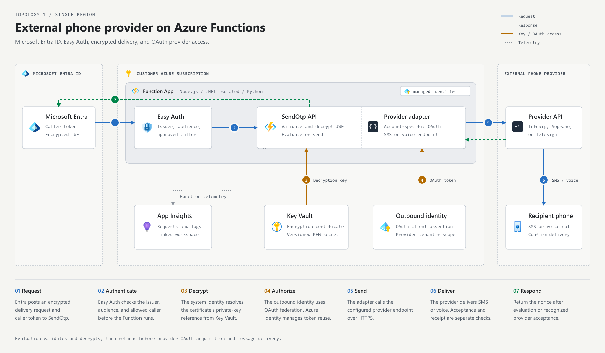

# External Phone Provider Azure Function Sample

Connect Microsoft Entra ID to a phone provider for SMS and voice one-time passwords.
Guided setup deploys **one regional endpoint** using JavaScript by default, with C# and Python options.

> [!IMPORTANT]
> Start in a separate nonproduction environment. Confirm provider access and Microsoft's approved
> test and activation process before deployment.

## Table of Contents

- [Features](#features)
- [Requirements](#requirements)
- [Architecture](#architecture)
- [Get started](#get-started)
- [Guidance](#guidance)
- [Advanced topics](#advanced-topics)
- [Getting help](#getting-help)

## Features

- JavaScript, C#, and Python implementations of one [HTTP and trust contract](docs/CONTRACT.md).
- Guided Azure deployment with Easy Auth, Key Vault, and monitoring.
- Evaluation mode checks authentication and decryption without sending a message.
- Built-in provider integrations and an [Add Twilio](docs/BRING-YOUR-OWN-PROVIDER.md) guide.

## Requirements

- Use a separate test environment with a Microsoft Entra ID tenant, Azure subscription, app
  registration, and unique resource name prefix.
- Check [roles, permissions, tools, regional availability, and quota](setup/docs/README.md#prerequisites-for-step-2).
- Plan for Azure, telemetry, and provider charges. The [cost estimate](docs/COST-CALCULATOR.md) is not a bill.
- Use Easy Auth to allow only the approved Microsoft caller.

## Architecture

*Easy Auth checks the Microsoft caller before the Function decrypts the request.
Live success confirms provider acceptance. Confirm delivery separately. Evaluation validates the
request without sending a message.
The diagram is a topology overview; current packages read API-key secrets for each live request,
while Azure Identity owns OAuth token caching.
See [architecture details](TECHNICAL.md#single-region-architecture).
[Open the full-size diagram](docs/images/single-region-architecture.png).*

## Get started

Follow the **[five-step setup guide](docs/GETTING-STARTED.md)** in order:

1. [Get ready](docs/GETTING-STARTED.md#1-get-ready): confirm access, approvals, permissions, and budget.
2. [Register the app](docs/GETTING-STARTED.md#2-register-your-application): save the tenant and client IDs.
3. [Deploy](docs/GETTING-STARTED.md#3-run-guided-setup): choose the provider and hosting plan.
4. [Connect and test](docs/GETTING-STARTED.md#4-connect-your-provider-and-test): configure provider access and run approved checks.
5. [Activate and hand over](docs/GETTING-STARTED.md#5-activate-and-hand-over): activate after validation and assign owners.

Before live use, review [production readiness](TECHNICAL.md#production-readiness).

## Guidance

| Goal | Start here |
| --- | --- |
| Deploy and configure | [Five-step setup](docs/GETTING-STARTED.md) |
| Find settings and provider details | [Technical reference](TECHNICAL.md) |
| Resolve a problem | [Troubleshooting](setup/docs/Troubleshooting.md) |
| Monitor the endpoint | [Monitoring](docs/MONITORING.md) |
| Review the API | [Send OTP](docs/CONTRACT.md) |
| Add Twilio | [Twilio integration guide](docs/BRING-YOUR-OWN-PROVIDER.md) |
| Work on a runtime | [JavaScript](javascript/README.md), [C#](dotnet/README.md), or [Python](python/README.md) |

### Advanced topics

- [Multi-region routing](docs/FRONTDOOR.md)
- [Secondary-provider design](docs/MULTI-PROVIDER-IMPLEMENTATION.md)

## Getting help

- [Provider access, testing, and activation](docs/ONBOARDING.md#before-purchasing-or-deploying)
- [Setup and endpoint troubleshooting](setup/docs/Troubleshooting.md)
- [Repository issues](https://github.com/Azure-Samples/ExternalPhoneProvider-AzureFunction-Sample/issues)

Keep credentials, phone data, OTPs, encrypted bodies, and raw provider responses out of issues
and support requests. See the [complete documentation index](docs/README.md).
