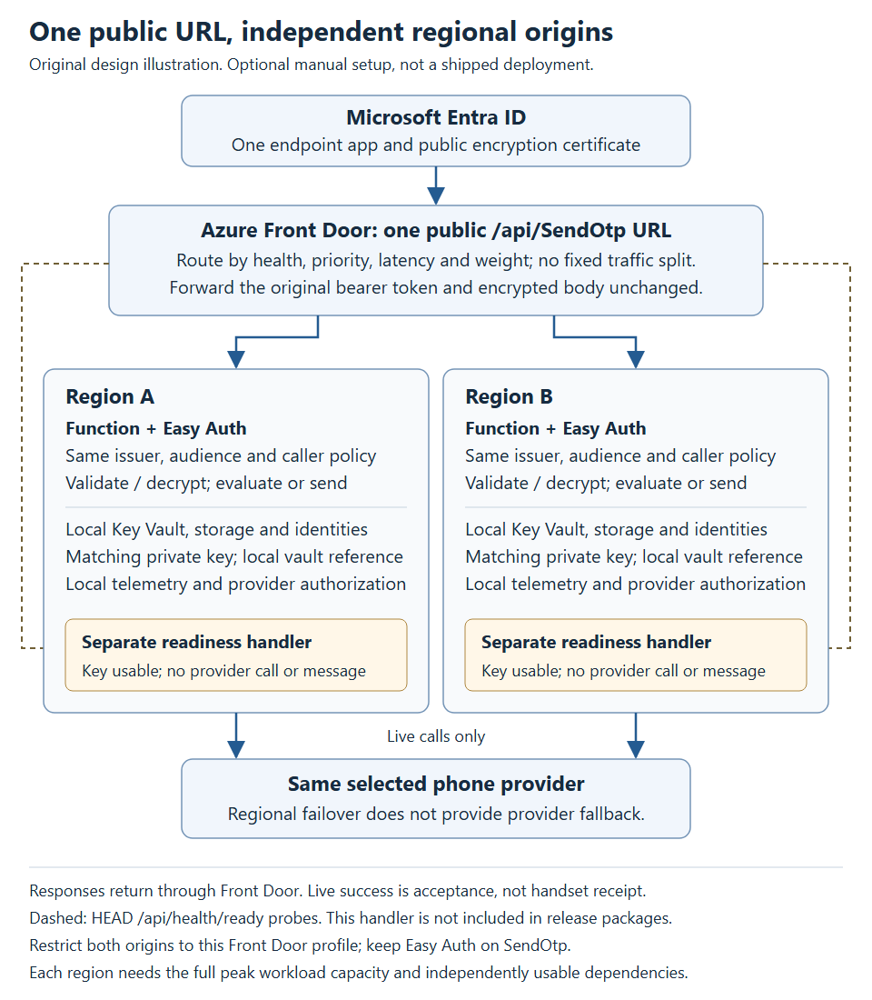

# Azure Front Door multi-region deployment

[Documentation](README.md) | [Single-region setup](GETTING-STARTED.md) | [Routing troubleshooting](../setup/docs/Troubleshooting.md#optional-front-door-deployments)

Azure Front Door provides **one public EPP URL backed by Function Apps in multiple regions**.
Start with a validated [single-region deployment](GETTING-STARTED.md), then use this guide to
plan and implement the regional origins, readiness route, Front Door configuration, validation,
failover drills, and rollback. Include transition errors in the acceptance checks.

Follow [scope](#scope-and-observed-behavior), [architecture](#architecture),
[plan/capacity](#1-plan-the-regional-deployment), [origins/keys](#2-prepare-equivalent-independently-provisioned-origins),
[readiness](#3-provide-a-non-delivering-readiness-endpoint), [routing](#4-configure-front-door-manually),
[validation](#5-validate-before-manually-activating-policy), and [fire-drill](#6-regional-failover-fire-drill).
Use [historical results](#observed-failover-results-and-limitations) as background for the
acceptance plan. After validation, follow [operations and rollback](#operations-and-rollback).

## Scope and observed behavior

Testing used isolated JavaScript origins, Front Door Standard, two/three regions, a shared key,
and a separate non-delivering readiness handler. It covered encrypted evaluation, invalid callers,
direct-origin restrictions, and individual Function stop/restart.

Implement the [readiness contract](#3-provide-a-non-delivering-readiness-endpoint) as part of each
regional package and validate it before enabling probes. The released packages remain the
single-region baseline; include runtime-specific validation for .NET or Python.

The recorded trials cover encrypted evaluation, caller and origin restrictions, and controlled
Function stop/restart. Build the acceptance plan around the features in use. It can include approved live SMS and voice
checks, real Microsoft Entra caller behavior, regional dependency loss, custom domains, WAF or
Private Link, and realistic load.

### Regional resiliency responsibility

Microsoft defines, configures, documents, and validates its standard regional-failover baseline
and exercise procedure. Customers operate that baseline: ownership, capacity, credentials and
keys, monitoring, and approved drills. An alternate topology becomes a customer-owned design
with its own validation plan.

Use single-region onboarding as the foundation, then add Front Door, readiness, dependency
isolation, survivor capacity, real-caller checks, and regional-outage evidence. Deployment owners
set RTO/RPO, tolerable failures, latency, and evidence requirements; historical results provide
test context rather than those targets.

## Architecture

The diagram shows the design, not the exact test deployment. Its region names are examples.
Custom domains and Premium/WAF are optional and were not part of the Standard-tier test.
Give each Function App, storage account, and Key Vault a globally unique name. Each region also has
its own identity IDs and vault references. Keep the **provider and authentication configuration
consistent and use the same RSA key**, rather than copying every setting literally.
The SMS/voice arrows show live delivery. Evaluation returns the nonce without contacting the provider.
The diagram's provider-secret arrows apply to API-key integrations; OAuth uses each region's
outbound managed identity. Match the key material across regions, not the vault URLs or version IDs.

| Component | Purpose |
|---|---|
| Front Door profile and endpoint | Provide the single hostname used by the caller. One endpoint is sufficient for regional redundancy. |
| Route | Match `/api/SendOtp` and forward the request to the EPP origin group over HTTPS. |
| Origin group | Contain the regional Function hostnames and their health, priority, weight, and latency settings. |
| Regional origin | Run the same selected implementation and provider integration, with local storage, Key Vault, identity, and telemetry. |

The caller uses `https://<front-door-host>/api/SendOtp`, not a list of regional URLs.
Front Door chooses an origin based on health, priority, latency, and weight. Equal priorities
allow both origins to serve traffic. Equal weights do **not** guarantee a 50/50 split. Adding a third region
normally adds an **origin**, not another customer-facing endpoint.

### Two-region baseline to provision and validate

Use two separate regional stacks, A and B, at equal Front Door priority for active-active service.
Each stack has its own Function App, hosting capacity, private package storage, Key Vault, managed
identities, and telemetry. Both vaults contain the matching decryption key and the provider
credentials needed in that region. Configure provider federation for each regional outbound
identity when required. Verify that each stack can start, resolve keys, refresh credentials, and
serve requests without the other region's storage, vault, or identity.

Keep one shared Front Door public SendOtp URL and endpoint application registration, with identical
issuer, audience, authorized-caller policy, selected provider route, and encryption public-key
identity across both stacks. Replicate and renew the matching private key securely in each regional
vault using the [key coordination procedure](#coordinate-the-encryption-key). Failover must not
require changing the caller URL, trust configuration, or registered encryption certificate.
Front Door, Entra authentication, and the selected provider remain shared dependencies; regional
duplication does not add provider failover or remove those dependencies.

## 1. Plan the regional deployment

Build the regional design in an isolated nonproduction tenant and subscription, separate from
live traffic. Review the
[setup prerequisites](../setup/docs/README.md#prerequisites-for-step-2) and
[regional quota guidance](../setup/docs/Troubleshooting.md#deployment-fails-with-subscriptionisoverquotaforsku).

- Start with two regions, based on service availability, capacity, residency, and the selected
  Security Store provider's requirements. A third region adds cost and capacity, but does not
  necessarily shorten failure detection.
- Check availability of **every** required resource type, not just EP1 quota. Hosting availability
  does not mean Application Insights or other dependencies are available there.
- Budget for an EP1 plan and regional dependencies in each region, Front Door, and telemetry.
  Size and validate each region for the survivor workload described below, not just its normal share.
- Choose one language and verify that each origin receives the same package. Do not mix
  implementations or package versions while measuring failover.
- Record the endpoint application's client ID, validated token audience and issuer, authorized
  caller application ID, certificate/public-key identity, selected provider route, and regional owners.
- Plan manual rollout, validation, certificate renewal, monitoring, and rollback before activation.

Use the regional procedure in this guide rather than rerunning `Setup-Epp.ps1` against the same
application. The setup script creates one region; the steps below coordinate Front Door, shared
key material, regional registrations, and failover without replacing an existing endpoint's
application configuration or certificate unexpectedly.

### Regional capacity

**Size and validate each region to serve the full combined peak workload.** In a balanced
two-region active-active design, each region needs capacity for **at least twice its normal
traffic**. Add room for bursts, approved retries, probes, and dependencies. Reserve this
capacity in both A and B before using regional failover. Retry capacity does not change the rule
to check an uncertain live send before retrying.

Use the expected peak workload rather than a quiet-period average. Equal weights do not guarantee
equal routing. If traffic is uneven, each region still needs the combined peak plus headroom, so
the less-used region may need more than twice its usual traffic. For more than two regions,
document the failure budget and measure capacity for every allowed survivor group and routing
pattern.

Record the workload mix, offered and completed request rates, concurrency, payload sizes, test
duration, per-region latency percentiles, errors/timeouts, resource saturation, and dependency
throttling. Verify hosting/subscription quotas, available warm capacity and scale-out delay,
storage and vault limits, identity/token-service capacity, and provider account/rate limits.
Use measured load results in both failover directions. Autoscale limits, instance counts, and
approved quotas are inputs, while sustained request rate, latency, errors, and saturation show
whether the design meets the agreed capacity target. This guide does not include a measured
production result.

Encrypted evaluation requests bypass request-path provider credential resolution and outbound
provider calls. A double-load evaluation drill proves only the exercised ingress, authentication,
decryption, and routing path, **not complete live-send capacity**. Background credential refresh
can still run independently; its presence does not prove live-path credential capacity.

For full-path capacity evidence, test both survivor regions with a **non-delivering,
provider-approved sandbox or stub**. Exercise the live request path, credential refresh, realistic
provider delay, and quota or throttling behavior. If the test system cannot match part of
production, record the difference and add provider capacity evidence. Include cold starts, cache
expiry, and key refresh so warm caches do not hide a regional dependency. Keep this test separate
from the evaluation-only fire drill, and use live sends only through a separately approved test.

## 2. Prepare regional origins

Create each regional Function App and its dependencies through your approved Azure process.
Keep public access disabled while setting up authentication, keys, identities, and packages.

1. Use the same endpoint application and validated issuer/audience/caller policy on every origin.
   Enable Easy Auth with `requireAuthentication=true`, `Return401`, and HTTPS required.
   Keep a nonempty `allowedApplications` list pinned to the authorized caller.
2. Retain the same [SendOtp contract](CONTRACT.md#1-http-api). Front Door must preserve the caller's
   `Authorization` header and encrypted request body. Its hostname is not automatically the token
   audience, and its profile ID is not the caller application's ID.
3. **Do not enable Front Door managed-identity origin authentication on this route.** That feature
   replaces the `Authorization` header. The original caller token must reach
   Easy Auth. Managed identity is still used by each Function for its own Azure dependencies.
4. Deploy the same package using private storage and managed-identity access. Keep SCM/basic
   publishing authentication protections in place; do not open administrative endpoints to bypass
   a deployment failure.
5. Configure the selected Security Store integration consistently in every region. Use each
   region's own credential vault and identities; complete provider consent or credential setup as
   required. If the integration uses managed-identity federation, configure trust for each regional
   outbound identity on the authorized client application; do not reuse another region's identity ID.
   Do not forward the incoming caller token to the provider.
6. Configure regional Application Insights/Log Analytics and verify ingestion. Avoid making a
   serving origin depend on another region's credential vault or package storage.

### Coordinate the encryption key

The caller must be able to encrypt once for any eligible origin. Every origin needs the
**same RSA private key corresponding to the registered public certificate**. Front Door's HTTPS
certificate is separate from this JWE encryption certificate.

- Use an approved secure replication process. The test used Key Vault certificate backup/restore,
  which transfers an Azure-encrypted backup rather than a plaintext private key.
- Key Vault backup/restore is restricted to the **same subscription and Azure geography**. Do not
  assume it works across arbitrary subscriptions or geographies; obtain an approved alternative
  design if these constraints do not fit.
- Give each Function identity scoped access to its regional vault. Set `EPP_DECRYPTION_KEY_PEM`
  to the regional certificate's **versioned PEM backing-secret reference**.
- Verify that the public keys match and each region can decrypt a request. Matching vault names
  or secret-version strings alone does not prove this.
- Restored certificates are independent copies. They do not stay in sync automatically. Coordinate renewal
  and Entra updates across every origin using the [certificate lifecycle guidance](../setup/docs/README.md#encryption-certificate-lifecycle).
  That section explains the single-key constraints; apply the multi-region updates through an
  approved manual procedure, not independent setup reruns. The sample has one active decryption
  key; it does not implement overlapping multi-key rotation.
- Keep plaintext keys out of source, logs, tickets, and pipeline artifacts. Protect and remove
  temporary encrypted backups under the approved handling policy.

## 3. Provide a non-delivering readiness endpoint

Front Door's health probes do not carry the Entra caller token. Probing the protected `SendOtp`
endpoint would test authentication failure rather than application readiness.

Implement a separate route such as **`/api/health/ready`** with this contract:

- Support HTTPS `HEAD` and `GET`; return no response body for `HEAD`.
- Return `200` only when the handler is running and the configured RSA decryption key is usable.
  Return a generic `503` when not ready.
- Do not send an OTP or call a phone provider. Do not return a nonce, keys, credentials, or detailed
  configuration. Use `Cache-Control: no-store`.
- If the route requires an Easy Auth exemption, exempt **only that exact readiness path**.
  Never exempt `/api/SendOtp`, `/api/*`, or the whole application.
- Keep the origin-level Front Door access restrictions described below on the readiness route too.

Readiness confirms that the handler and decryption key are usable. Validate provider availability
and handset delivery separately. Point probes to the implemented readiness handler, return a live
result rather than a cached static `200`, and keep Easy Auth enabled for SendOtp. Front Door treats
only a `200` probe response as healthy.
If every origin is unhealthy, Front Door can still route requests across them. Keep authentication
and application failure handling effective independently of probe status.

## 4. Configure Front Door manually

In the Azure portal, create a Front Door Standard/Premium profile, an endpoint, and an origin group.
These are the **tested starting settings**. Validate them against the required performance target:

| Setting | Tested value |
|---|---|
| Tier and domain | Standard, using its generated `azurefd.net` hostname |
| Origin hostnames | Each Function App's actual default hostname |
| Origin host header | That origin's Function hostname, not the Front Door hostname |
| Origin transport | HTTPS, port 443, certificate-name validation enabled |
| Origin priority and weight | Priority `1`, weight `1000` for every origin |
| Session affinity | Disabled |
| Health probe | HTTPS `HEAD` to the implemented `/api/health/ready` route |
| Probe interval | 30 seconds |
| Sample size / required successes | 4 / 3 |
| Additional latency | 50 milliseconds |
| Origin response timeout | 30 seconds; this is not the caller's OTP deadline |
| Route paths | `/api/SendOtp` and the implemented readiness path |
| Accepted/forwarding protocol | HTTPS only |
| Link to default domain | Enabled |
| Caching | Disabled |

Create the route under **Front Door manager**, associate it with the endpoint's domain, and select
the origin group. Inspect **Origin groups > selected group > Origins** to view the regional backends.
The profile should show one public endpoint with several origins.

Use the same request body and caller authorization end to end. Do not add header-replacement,
redirect, cache, or retry rules without separately validating their effect on authentication and OTP
delivery. A cached response cannot confirm a new delivery request. Front Door does not cache POST.

### Restrict origin access

Before allowing Front Door to reach the Functions, configure their access restrictions:

1. Allow the **`AzureFrontDoor.Backend` service tag** with an additional **`X-Azure-FDID`** header
   condition matching this profile's Front Door ID.
2. Set unmatched requests to **Deny**. Both the source restriction and header condition are
   required; the header alone can be spoofed.
3. Keep Easy Auth enabled for SendOtp. Restricting the network path does not authenticate the caller.
4. Open only the access needed by this public-origin design after the configuration is verified.
   A publicly resolvable hostname does not mean direct requests should be allowed.

Premium with Private Link is an alternative origin-security design, but was not tested here.
WAF policies and custom domains also need separate configuration and validation.

## 5. Validate before manually activating policy

Use an approved test caller and synthetic encrypted **evaluation** requests first. Check returned
nonces locally without writing them or request bodies to shared logs.

- Confirm all origins use matching package bytes, usable regional key references, and the intended
  Easy Auth issuer, audience, and caller restrictions.
- Direct origin requests must be denied, including requests with a spoofed `X-Azure-FDID`.
- Through Front Door, missing/invalid/wrong-audience tokens and unauthorized callers must fail.
  Send valid evaluation requests before and after testing an unauthorized caller. This confirms
  that the rejection came from access control, not a general outage.
- Valid encrypted evaluations must return the matching nonce. Malformed/tampered requests must
  not be accepted. Use safe correlation IDs and regional logs to confirm which origins handled requests.
- Run the [regional failover fire-drill](#6-regional-failover-fire-drill) in both directions, with
  agreed acceptance criteria and evidence for the [capacity gate](#capacity-gate-each-region-must-support-the-combined-peak-load).
- Separately test approved live SMS/voice delivery and caller behavior with the provider and EPP
  onboarding owner. Evaluation does not prove either.

Once these checks pass, have an **Authentication Policy Administrator** follow the
[supported activation procedure](../setup/docs/README.md#step-3---manually-validate-and-activate-policy),
using the Front Door SendOtp URL and endpoint application client ID. Save the previous policy first,
preserve unrelated properties, and read the policy back to confirm the change. This step is manual.

### Test scenarios to plan and record

**Proposed tests, not completed results.** Historical [app-stop trials](#observed-failover-results-and-limitations)
do not prove double-load capacity, dependency isolation, or a regional outage.
Approve synthetic data, bounded load, and the [drill's abort/restoration safeguards](#6-regional-failover-fire-drill)
in isolated nonproduction. Agree load/headroom, recovery, errors/latency, soak, and restoration deadlines first.

Use an authorized harness, **not a real Microsoft Entra ID sign-in flow**. Evaluation suppresses
sends only inside this endpoint; caller fallback/retries can still deliver. Confirm caller behavior
with Microsoft and obtain separate approval for sign-in or delivery tests.

| What to test | How and where to test safely | Expected outcome / acceptance | Evidence to keep |
|---|---|---|---|
| Baseline encrypted evaluation | Send synthetic encrypted `mode: 2` requests through Front Door with both origins healthy. Confirm each origin serves requests. | Matching nonce checked locally, no delivery, and agreed baseline error/latency limits met. | Offered/completed rates, latency/errors, safe correlation IDs and serving region; no nonce values or request bodies. |
| Bad caller credentials, unauthorized callers, and direct-origin access | From the test harness, try missing/invalid/wrong-audience tokens, an unauthorized app, and direct-origin requests including a spoofed `X-Azure-FDID`. Send valid evaluations before and after. | Invalid calls are rejected while valid evaluations still work. Authentication and ingress restrictions remain enabled. | Response status and sanitized access diagnostics identifying the rejection; successful surrounding evaluations. |
| Failover from A to B | Follow the fire-drill: isolate only approved test origin A while leaving it **enabled in Front Door**. Keep B healthy and evaluation traffic bounded. | Health-based rerouting to B meets agreed recovery and transition-error limits, without changing the public URL, trust, or encryption key. | Fault/probe/client timestamps, every failure/timeout, and B's request/health signals. |
| Failover from B to A | After A is fully restored and stable, repeat with B isolated but **enabled in Front Door**. | A meets the same agreed criteria; a one-direction pass is insufficient. | The same evidence, identifying A as the survivor and confirming B's subsequent restoration. |
| Sustained survivor capacity | In each direction, maintain the [combined peak offered load plus planned headroom](#capacity-gate-each-region-must-support-the-combined-peak-load) for the agreed soak. | **Each region handles at least double its normal share in the balanced two-region case, plus headroom**, within agreed error/latency and dependency limits. Evaluation proves only the exercised path. | Offered/completed rates, concurrency, latency percentiles, errors/timeouts, saturation/throttling, quotas and available capacity per region. |
| Restart, cold start, and credential refresh without the failed region | In a separately approved dependency-isolation test environment, make the failed region's storage/vault paths unavailable and start or restart the survivor stack. Exercise key resolution and credential refresh using the non-delivering provider setup below. Do not add a second fault to the basic fire-drill. | The survivor starts and serves using its own dependencies; warm caches do not hide cross-region access. Missing failed-region telemetry is not treated as success. | Dependency configuration/access evidence, startup/key/credential-refresh results, client outcomes and timestamps captured outside the failed region. |
| Complete live-path capacity and provider credential failures | Separately use a provider-approved, production-representative **non-delivering sandbox/stub** exercising credential acquisition/refresh and provider latency/quota behavior. Test valid and invalid/expired test credentials without production accounts or recipients. | Both survivor regions meet the capacity criteria on this path; credential failures are surfaced, not reported as successful sends. Evaluation-only throughput cannot pass this test. | Credential/provider timing, failures/throttling, load results, and provider capacity/quota evidence for behavior the sandbox/stub cannot reproduce. |
| Restoration and conservative failback | Restore the original approved state even after a failed test. Verify the restored origin's own readiness and successful evaluations, then observe traffic returning for the agreed window. | Both origins are healthy and serving within agreed limits, with original security settings intact, before any next fault. | Restoration confirmation, origin-specific readiness/request evidence and failback latency/errors. |
| Interrupted-controller recovery | Verify the independent restoration timer or backup operator before fault injection. In an approved drill, interrupt the controller while the independent safeguard remains available. | The fault is removed by the agreed deadline without relying on the interrupted controller; unsafe load stops and unresolved recovery is escalated. | Interruption/restoration timestamps, safeguard or backup-operator actions, and both origins' final state. |

For every row, record **pass, fail, or not tested**, the approved target, observed outcome, and
evidence location. Assign an owner and retest date to gaps. A successful routing test is useful,
but is not a substitute for the separate capacity and dependency tests.

## 6. Regional failover fire-drill

Run this drill in an approved nonproduction environment built for failover testing. It exercises
health-based rerouting without affecting production and covers the documented scenario rather than
every possible regional outage. Define numeric pass/abort thresholds and durations before starting
instead of treating the observed timings below as an SLA.

1. **Approve the boundary.** Name the drill, change, telemetry, and restoration owners plus a
   backup. Record the exact test resources, window, isolation deadline, and restoration steps.
   Confirm no production policy or real users depend on them; isolate only one origin at a time.
2. **Prepare safe traffic and recovery.** Use an authorized caller with bounded encrypted
   `mode: 2` evaluation traffic—never live sends or real recipient data. Set rate, concurrency,
   timeout, duration, and cost limits. Keep the controller/evidence outside the target region and
   verify an independent restoration mechanism or backup operator.
3. **Set the baseline and gates.** Save the approved routing, authentication, ingress, package,
   key, and dependency state. Confirm both origins are healthy and serving. Agree survivor load,
   soak time, recovery target, allowed failures/timeouts, latency/resource limits, failback window,
   and abort thresholds before injecting a fault.
4. **Isolate one origin without disabling it in Front Door.** Apply an approved reversible fault,
   such as stopping the test Function App, and timestamp request and confirmation separately.
   Keep the survivor unchanged. Do not weaken Easy Auth or ingress; probe health is not a security boundary.
5. **Measure detection and survivor behavior.** Maintain the bounded combined-peak evaluation load
   plus headroom. Capture every attempt, failure, timeout, latency, safe correlation ID, probe,
   routing, and regional dependency signal. Missing telemetry is not success. Meet the full soak
   criteria; evaluation-path results do not replace the separate live-path capacity evidence.
6. **Restore on completion or abort.** Stop unsafe load and restore the saved state at the deadline,
   any abort threshold, or completion. Cleanup must run even if assertions or the controller fail.
   Escalate immediately if restoration cannot be confirmed.
7. **Verify failback, then reverse direction.** Check the restored origin's dependencies, key and
   credential resolution, readiness, and evaluation responses. Wait through the agreed stable
   observation window before testing the other origin. Both directions must pass.
8. **Record results and gaps.** Keep sanitized approvals, configuration/package identifiers,
   workload limits, timestamps, rates, latency/errors, dependency evidence, aborts, and restoration.
   Mark each criterion pass/fail/not tested with an owner and retest date. Never attach secrets,
   bearer tokens, request bodies, OTPs, or nonces.

### Additional validation

Stopping a Function App tests routing when one application origin is unavailable. Add separate
nonproduction tests for regional storage, vault, identity access, network paths, control plane,
and telemetry. Capture evidence outside the affected region. Include cold startup, credential
refresh, and restoration so the plan covers more than an already-warm app. Record any scenario
that cannot be tested safely and assign an owner and follow-up date.

Use separate approved checks for real Microsoft Entra caller timing, provider acceptance, and
handset delivery. Define retry and availability targets with the provider and onboarding owner.
Front Door and this runbook do not guarantee zero downtime or make uncertain retries safe.

## Observed failover results and limitations

We stopped one Function App in these JavaScript tests, **not an entire Azure region**. One test
client in Central US sent encrypted evaluation requests without delivering messages. The first two
origins were in Central US and West US 2. The third was in West US 3.
We stopped the Central US Function after confirming it was serving requests. All trials used
a sample size of 4 with 3 successes required to consider an origin healthy.

| Origins | Probe interval | Failed requests in matched first 8 minutes | Sustained success after stop confirmation |
|---|---|---|---|
| 2 | 30 seconds | 32/478 (6.7%) | About 144 seconds |
| 2 | 10 seconds | 58/471 (12.3%) | About 154 seconds |
| 3 | 30 seconds | 33/462 (7.1%) | About 123 seconds |
| 3, repeat | 30 seconds | 32/460 (7.0%) | About 150 seconds |

Transient request failures occurred during the controlled app-stop tests. Healthy origins continued
serving, and sustained successful responses resumed. No HTTP 5xx responses were observed. These
results show recovery in the tested scenarios, not uninterrupted service or resilience to a complete
regional outage.

"Sustained success" means every sampled request after the last failure succeeded, with at least
30 seconds of successful traffic before we restarted the Function. We measured from when Azure
confirmed the stop, which may differ from when the Function actually stopped serving.
We aimed for one request per second, but slow responses and timeouts reduced the sample counts.
The test controller was interrupted during one three-origin trial, extending that outage while we
recovered it. To keep the comparison fair, the table uses only the first eight minutes of each outage.
We saw no failed samples before the outages or after restarting the Functions.

A failed request is not guaranteed to be replayed on another origin. The actual Entra caller's
handling of these errors was not tested.

These trials did not show a consistent benefit from 10-second probes or a third region.
More regions can add capacity and help tolerate additional failures, but they do not remove routing
delays, shared provider dependencies, or application faults. Faster probes generate more traffic
and can make brief problems trigger routing changes sooner. Decide how much disruption your
application can accept, then repeat the tests from your callers' locations and at your expected load.

Do not add blind retries to live sends: a timeout can occur after provider acceptance, and the sample
does not deduplicate deliveries. These results do not establish zero downtime, a production SLA,
or successful delivery to a phone.

## Operations and rollback

- Monitor each origin, Front Door health-probe/access diagnostics, authentication failures, key
  reference resolution, certificate expiry, and provider outcomes. Never log OTP bodies, private keys,
  bearer tokens, or nonce values.
- Roll out package/configuration changes deliberately and validate each region. Restore failed test
  origins and verify they are serving; `Running` alone does not prove readiness.
- Keep the reviewed pre-change policy, origin access restrictions, authentication settings, and
  certificate-version references. If rolling back to a direct Function URL, first restore its
  approved single-region access policy **while retaining Easy Auth**, otherwise Front Door-only
  restrictions will block the direct caller.
- Have the policy administrator restore the reviewed URL/app ID through the supported procedure,
  read it back, and validate delivery. Do not delete resources as a substitute for policy rollback.
- Retire extra resources only after traffic and policy rollback are confirmed. Front Door, regional
  plans, and telemetry remain billable until appropriately decommissioned; respect Key Vault purge
  protection and retention.

## References

- [Front Door routing methods](https://learn.microsoft.com/azure/frontdoor/routing-methods)
- [Health probes and all-origins-unhealthy behavior](https://learn.microsoft.com/azure/frontdoor/health-probes)
- [Origin security and caller-header considerations](https://learn.microsoft.com/azure/frontdoor/origin-security)
- [Front Door caching](https://learn.microsoft.com/azure/frontdoor/front-door-caching)
- [Key Vault backup/restore constraints](https://learn.microsoft.com/azure/key-vault/general/backup)
