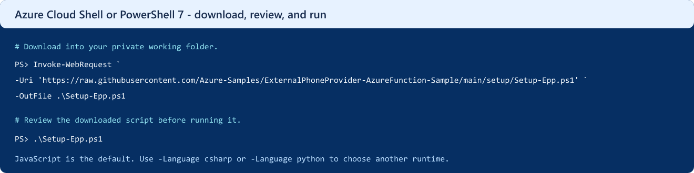
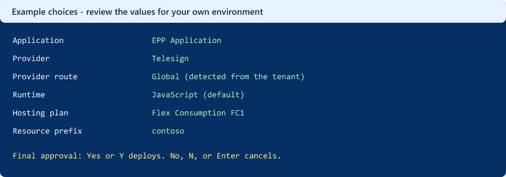
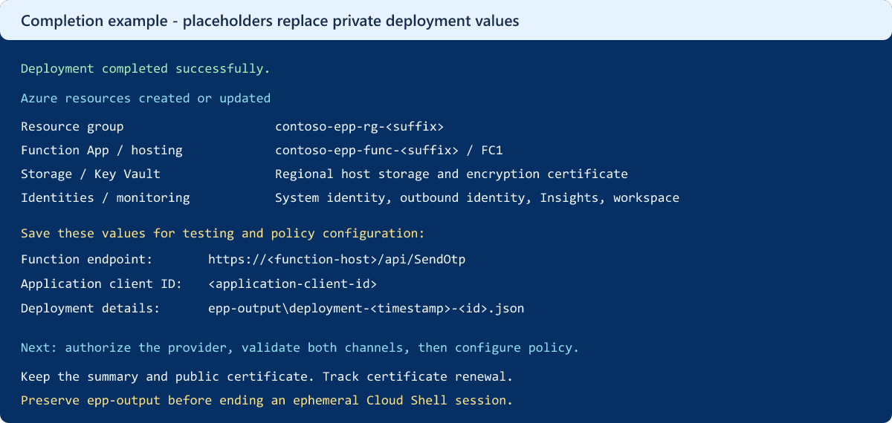

# Deploy an external phone provider endpoint

[Documentation](README.md) | [Setup reference](../setup/docs/README.md) | [Troubleshooting](../setup/docs/Troubleshooting.md)

Deploy one Azure Function endpoint that connects Microsoft Entra ID to **Infobip, Soprano, or
Telesign** for SMS and voice. Complete these four steps in a test environment before live use.

## 1. Get ready

1. Review [Microsoft's telephony-provider guidance](https://learn.microsoft.com/entra/identity/authentication/concept-phone-providers)
   and confirm provider availability, account access, channels, destinations, and pricing.
2. Prepare a Microsoft Entra ID tenant, an Azure subscription, and an onboarding owner.
3. Use **Azure Cloud Shell in PowerShell mode** or **PowerShell 7+** with Azure CLI installed.
   Setup requires Azure CLI **2.60.0+ for Flex Consumption (FC1)** or **2.48.1+ for Premium (EP1)**.
4. Arrange Azure deployment and role-assignment permissions and the required Microsoft Entra roles.
   Setup needs a **Privileged Role Administrator** for its Microsoft Graph grant.
   Activation is a separate task for an **Authentication Policy Administrator**.
5. Check regional availability, quota, and the [cost estimate](COST-CALCULATOR.md).

See [prerequisites](../setup/docs/README.md#prerequisites) for the complete permissions and tools.
Setup can install Bicep after confirmation.

<a id="2-register-your-application"></a>
<a id="2-let-guided-setup-create-your-application"></a>
<a id="3-run-guided-setup"></a>
<a id="3-download-and-run-the-setup-script"></a>
## 2. Download and run the setup script

First confirm the [required access and tools](#1-get-ready).
Open PowerShell in a private working folder and download the launcher:

```powershell
Invoke-WebRequest `
    -Uri 'https://raw.githubusercontent.com/Azure-Samples/ExternalPhoneProvider-AzureFunction-Sample/main/setup/Setup-Epp.ps1' `
    -OutFile .\Setup-Epp.ps1
```

Review the downloaded script, then run it:

```powershell
.\Setup-Epp.ps1
```

JavaScript is the default. To choose another runtime, use
`.\Setup-Epp.ps1 -Language csharp` or `.\Setup-Epp.ps1 -Language python`.
On a shared workstation, add `-ForceAuthentication` for a fresh sign-in.



Complete the prompts:

| Choice | Guidance |
| --- | --- |
| Tenant and subscription | Select the customer environment prepared in Step 1. |
| Application | Choose **Create a new application** and accept **EPP Application** or enter your own name. For a rerun, select the existing application. |
| Azure region | Choose an available region that meets your organization's requirements. EU tenants receive EU Data Boundary recommendations. |
| Provider | Enter **Infobip**, **Soprano**, or **Telesign**. |
| Hosting plan | **FC1** is the default and can scale to zero. **EP1** maintains paid warm capacity. See [plan details](../setup/docs/README.md#service-plan-selection). |
| Resource prefix | Use 2-8 lowercase letters or digits, starting with a letter. The default is `epp`. |

Setup detects **EU or Global provider routing** from the tenant and configures both channels.
It downloads the runtime's release package and verifies its checksum.



*Example choices. The prompts depend on your selected tenant and application.*

> [!IMPORTANT]
> If the application already has encryption certificates, **Replace is the default**.
> Select **Reuse** explicitly to keep the current certificate. Replacement affects every endpoint
> sharing the application. Review [certificate selection](../setup/docs/README.md#encryption-certificate-selection)
> before proceeding.

Review the deployment plan, including the accounts, region, provider URLs, resource names,
permissions, and certificate action. Enter **Yes** or **Y** to deploy. Enter **No**, **N**, or
press Enter to cancel.

If you chose a new application, the plan shows its display name and resource-name patterns.
After approval, setup prints the new client ID and resolved resource names.
For an existing deployment, use its original application client ID and resource prefix.

Keep the session open until setup reports **Deployment completed successfully** and saves the
deployment summary. Retain the private `epp-output` folder, especially when using an ephemeral
Cloud Shell session. You need the summary's **endpoint URL** and **application client ID** later.



To retain the handoff information:

1. Open the saved `deployment-*.json` and verify the tenant, subscription, provider, and resource names.
2. Record `endpointUrl`, `applicationId`, `encryptionKeyId`, and `certificateExpiresUtc`.
3. Retain the summary and public `.cer` file in restricted operational storage.
4. In an ephemeral Cloud Shell session, use its file-download controls to save these files before
   closing the session.

To find the created application later, open **Microsoft Entra admin center** > **App registrations**,
select the application, and open **Overview**. Use its **Application (client) ID**, not the Object ID.


Setup creates the Function App, hosting plan, storage, Key Vault, identities, and monitoring
resources. It verifies the encryption-key reference, Easy Auth, and Function registration.
Find the resources in the resource group recorded in the summary:


If setup fails after creating an application, reuse the client ID from
`application-<client-id>.json` and the original resource prefix. Follow
[safe recovery](../setup/docs/Troubleshooting.md#recover-without-destructive-cleanup)
instead of creating another app or deleting resources.

<a id="4-connect-your-provider-and-test"></a>
## 3. Connect your provider and test

1. Complete [provider OAuth authorization](ONBOARDING.md#complete-provider-authentication).
   Setup configures the customer-side federation; your provider authorizes the customer
   application and account.
2. In the Function App, open **Settings** > **Authentication**. Confirm that authentication is
   enabled, access requires authentication, and unauthenticated requests return **HTTP 401**.
3. Use the authorized Microsoft caller and the test procedure provided for your tenant to run
   the [endpoint checks](ONBOARDING.md#validate-the-deployed-endpoint).
4. Confirm caller rejection and successful **evaluation** before running a controlled live test
   for each intended channel.
5. Confirm provider acceptance, recipient delivery, and [request telemetry](MONITORING.md)
   separately.


Keep Easy Auth enabled. An ordinary Azure CLI token is not the authorized Microsoft caller.
Evaluation checks authentication and decryption without sending a message.
For live requests, `200` means provider acceptance. Investigate timeouts before retrying because
the provider might already have accepted the request.

<a id="5-activate-and-hand-over"></a>
## 4. Activate and hand over

Have the policy administrator follow the
[activation guidance](../setup/docs/README.md#activate-the-endpoint) for your tenant.
Use the endpoint URL and application client ID from the saved deployment summary:

1. Save the current SMS or voice policy and its targeting.
2. [Configure evaluation in Graph Explorer](../setup/docs/README.md#configure-evaluation-in-graph-explorer)
   using `telecomProviderSettings`.
3. Read back the saved policy and verify the endpoint, app ID, evaluation flag, and percentage.
4. Check evaluation telemetry, then [roll out live traffic](../setup/docs/README.md#evaluation-and-percentage-rollout)
   in agreed increments with controlled delivery checks.
5. Restore the previous policy if readback or delivery checks fail.

SMS and voice can use the same endpoint. Repeat policy configuration and validation for each channel.

Before handing over:

- Save the previous policy and agree on a [rollback procedure](../setup/docs/README.md#rollback-and-decommissioning).
- Confirm evaluation, controlled live delivery, and policy readback.
- Create and test [alerts and notifications](MONITORING.md#alerts).
- Assign owners for provider access, [certificate renewal](../setup/docs/README.md#encryption-certificate-lifecycle),
  support, and costs.

Keep the deployment summary, policy snapshots, and safe validation evidence in restricted storage.
