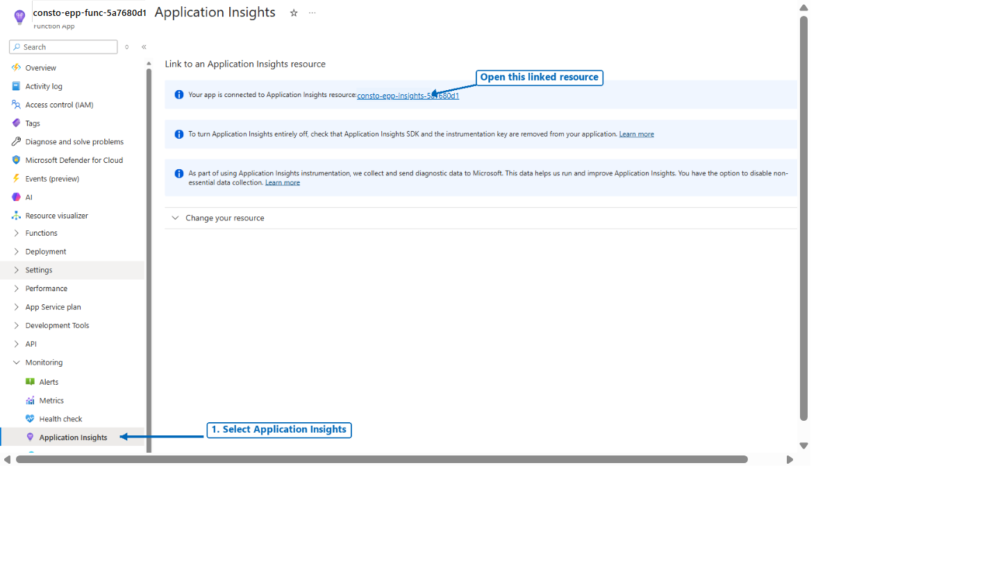
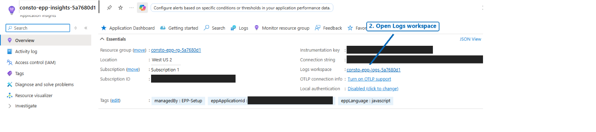
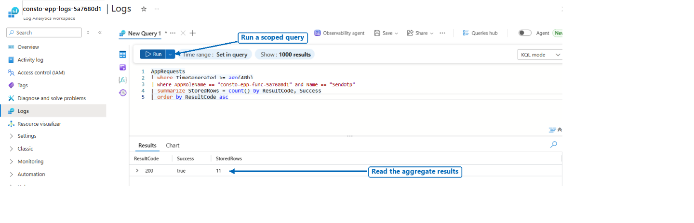

# Monitoring

<a id="monitoring-setup-and-sample-queries"></a>

[Documentation](README.md) | [Collection diagnostics](APPLICATION-INSIGHTS.md) | [Log schema](LOGGING.md) | [Endpoint troubleshooting](../setup/docs/Troubleshooting.md#after-deployment-triage)

This guide covers endpoint logs and alert configuration. Guided setup creates Application
Insights and a Log Analytics workspace; the operations team chooses, configures, and tests
notifications.

For **tenant authentication and potential abuse signals**, use
[Microsoft Entra ID sign-in monitoring](SIGN-IN-MONITORING.md). Endpoint setup does not configure that pipeline;
sign-in failures do not by themselves identify provider failures or prove OTP delivery.

For a first single-region deployment:

1. [Find the monitoring resources and confirm data is arriving](#1-record-the-deployment-and-confirm-telemetry)
   after an [authorized test](ONBOARDING.md#validate-the-deployed-endpoint).
2. Check [requests, failures, and latency](#2-single-region-function-queries), then use
   [the log format for your runtime](#runtime-specific-log-discovery).
3. [Set up and test alerts](#5-set-up-notifications-and-alert-rules), including certificate
   reminders and cost ownership.

For **missing data**, use [collection checks](#9-sampling-ingestion-gaps-privacy-and-validation).
Additional guidance covers [multiple regions](#3-multiple-regions-and-cross-workspace-queries),
[Workbook](#6-build-a-shared-operations-workbook), [availability checks](#7-availability-authenticated-functions-and-fc1),
and [Front Door](#8-optional-azure-front-door-layer). Start with the single-region steps above.

These examples do not create monitors automatically. Review permissions, privacy, and charges
before applying them. Thresholds and intervals are **starting points, not SLAs**; tune them to
your deployment.

<a id="1-record-the-deployment-and-confirm-telemetry"></a>
## 1. Record the deployment

Keep a private inventory with one row per expected regional endpoint:

| Inventory field | Purpose |
| --- | --- |
| Region and Function App resource ID | Identify the deployment and platform metric scope. |
| Application Insights resource ID and Log Analytics workspace ID | Identify the application telemetry source and query permissions. |
| Observed `AppRoleName` and `AppRequests.Name` | Filter this Function and its `SendOtp` request operation without mixing other apps or readiness probes. |
| Runtime, hosting plan, deployment version, and owner | Explain schema differences, cold starts, releases, and escalation. |
| Expected traffic or authorized synthetic-test cadence | Decide whether missing data is actionable, including standby origins. |
| Front Door profile, endpoint, origin group, and origin | Associate regional routing and health with the Function. |

Build the expected inventory from the deployment record. Recent telemetry alone can miss an
origin that has not reported.

[Guided setup](../setup/docs/README.md) creates the collection resources, not action groups,
Workbooks, or alerts. [Verify the deployed collection configuration](APPLICATION-INSIGHTS.md#single-region-configuration);
resource creation alone does not prove ingestion, and other deployment methods can differ.
The template requests 30-day retention; check effective workspace/table retention and policy before changes.

<a id="find-the-linked-resources-in-the-portal"></a>
### Portal resources

1. Open the Function App named in your deployment summary.
2. Select **Monitoring > Application Insights** and follow the linked resource name.
   Viewing logs does not require **Change your resource** or **Apply**.



3. On that Application Insights resource's **Overview**, find **Logs workspace** and open
   the linked workspace. Then select **Logs** in the workspace to use the queries below.



These test-deployment screenshots hide identifiers and connection details. Names, regions, and
layout may differ; navigation links do not prove successful traffic or delivery.

Keep connection strings and credentials private.
`AppRequests`/`AppTraces` are not interchangeable with `FunctionAppLogs` or `AzureDiagnostics`.
Diagnostic export alone does not prove request collection; platform metrics need no log export.
See [pipelines and table names](APPLICATION-INSIGHTS.md#signals-tables-and-metrics-are-different-things).

Use **Log Analytics workspace > Logs** for all KQL below. Application Insights'
application-context query experience can instead use names such as `requests`,
`traces`, `timestamp`, and `cloud_RoleName`; do not mix that schema with these
workspace examples. Replace every angle-bracket placeholder with your private
inventory value before running. `_ResourceId` in these application tables identifies
the **Application Insights component**, not the Function App.

Run this discovery query after a controlled authorized test. The examples use
`SendOtp` as the request name; replace that literal everywhere if your observed
`Name` differs. Confirm that the row really represents the OTP operation.

```kusto
AppRequests
| where TimeGenerated >= ago(24h)
| summarize StoredRows = count(), LastSeen = max(TimeGenerated)
    by _ResourceId, AppRoleName, Name
| order by LastSeen desc
```

Grant only required read access on **each workspace**. Workbook sharing does not grant data access;
alert evaluation needs its own identity's access, not the author's.

<a id="run-a-first-query-and-read-the-results"></a>
### First query

1. In your workspace's **Logs**, close any welcome or Queries hub dialog. If the portal opens
   in **Agent** mode, switch it off for this walkthrough, then choose **KQL mode**.
2. Paste the query below. Replace `<function-role-name>` with the `AppRoleName` you verified
   using the discovery query above. If a workspace contains multiple Application Insights
   components with that same role name, also filter by your component's `_ResourceId`.
3. Select **Run**, then read the **Results** grid. Adjust `ago(48h)` to include the time of
   your authorized test; this query sets its own time range.

```kusto
AppRequests
| where TimeGenerated >= ago(48h)
| where AppRoleName == "<function-role-name>" and Name == "SendOtp"
| summarize StoredRows = count() by ResultCode, Success
| order by ResultCode asc
```



*This real query returned 11 stored rows with result code 200 and `Success=true` in the example
window. The role and workspace names are hidden. The query shows counts only: no phone numbers,
message bodies, credentials, or raw trace messages. Your result counts will differ.*

`StoredRows` counts stored telemetry records, not delivered messages or necessarily all requests.
Sampling can change the count, and evaluation and live calls can both return HTTP 200. No rows
means no matching records in the selected scope/time range; it is not proof that nothing failed.
Use the scoped and sampling-aware queries below for ongoing monitoring.

## 2. Single-region Function queries

### Requests, failures, and latency

Scope to both the component and role, not merely the operation name. This query
reports five-minute buckets from the last hour:

```kusto
AppRequests
| where TimeGenerated >= ago(1h)
| where _ResourceId =~ "<application-insights-resource-id>"
| where AppRoleName == "<function-role-name>" and Name == "SendOtp"
| extend Weight = tolong(coalesce(ItemCount, 1))
| summarize Requests = sum(Weight),
    Failed = sumif(Weight, Success == false),
    UnknownOutcome = sumif(Weight, isnull(Success)),
    P50Ms = percentilew(DurationMs, Weight, 50),
    P95Ms = percentilew(DurationMs, Weight, 95),
    P99Ms = percentilew(DurationMs, Weight, 99)
    by bin(TimeGenerated, 5m)
| extend FailurePct = 100.0 * Failed / Requests
| order by TimeGenerated asc
```

`ItemCount` weights sampled records; counts/percentiles remain estimates, not recovery of lost data.
Empty buckets mean **no data**, not zero failures or availability. `Success` is a request outcome,
not handset receipt. HTTP 200 includes both evaluation and live calls; use
[classified service events](#separate-evaluated-accepted-and-failed-completions) where verified.

### Failure status breakdown

```kusto
AppRequests
| where TimeGenerated >= ago(1h)
| where _ResourceId =~ "<application-insights-resource-id>"
| where AppRoleName == "<function-role-name>" and Name == "SendOtp"
| where Success == false
| summarize Failed = sum(tolong(coalesce(ItemCount, 1)))
    by ResultCode, bin(TimeGenerated, 5m)
| order by TimeGenerated asc
```

Investigate application 4xx separately from provider/host 5xx. An Easy Auth
rejection can happen **before the Function executes** and need not produce an
`AppRequests` row or service event. Correlate with the available platform HTTP/auth
diagnostics and caller-side observations. Do not disable authentication to make a
monitor green.

## 3. Multiple regions and cross-workspace queries

For multiple apps in one workspace, query `AppRequests` once and keep
`_ResourceId` and `AppRoleName` as grouping keys. For separate regional workspaces,
use explicit workspace references. This two-region example keeps the regions
separate so a healthy region cannot hide another region's failures:

```kusto
union
    (workspace("<workspace-a-id>").AppRequests
     | where TimeGenerated >= ago(1h)
     | where _ResourceId =~ "<insights-a-resource-id>"
         and AppRoleName == "<role-a>" and Name == "SendOtp"
     | extend Region = "region-a"),
    (workspace("<workspace-b-id>").AppRequests
     | where TimeGenerated >= ago(1h)
     | where _ResourceId =~ "<insights-b-resource-id>"
         and AppRoleName == "<role-b>" and Name == "SendOtp"
     | extend Region = "region-b")
| extend Weight = tolong(coalesce(ItemCount, 1))
| summarize Requests = sum(Weight),
    Failed = sumif(Weight, Success == false),
    UnknownOutcome = sumif(Weight, isnull(Success)),
    P95Ms = percentilew(DurationMs, Weight, 95),
    P99Ms = percentilew(DurationMs, Weight, 99)
    by Region, _ResourceId, AppRoleName, bin(TimeGenerated, 5m)
| extend FailurePct = 100.0 * Failed / Requests
| order by TimeGenerated asc, Region asc
```

Use distinct sources and filters to avoid double counting. If combining an
overall failure rate, divide total failures by total requests; do not average
regional percentages. Query raw rows for an overall percentile rather than
averaging regional p95 values. A regional origin's request share depends on
routing policy, traffic geography, failover, and probe traffic; equal shares are
not an availability requirement.

Keep workspace references explicit in alert queries: they cannot be runtime
parameters. Do not use `isfuzzy=true` or best-effort unions to conceal an inaccessible
workspace. A query error is a monitoring failure to fix, not evidence of health.
See [cross-workspace query requirements][cross-workspace].

### Missing telemetry against the expected inventory

Use this only when each listed origin is **expected to receive matching requests**
in the observation window. For one region, keep one inventory row and use local
`AppRequests` as the `Observed` source. For multiple apps sharing a workspace, also
use the local table once instead of unioning the same table twice.

The example deliberately evaluates a delayed window, from 20 minutes ago to
5 minutes ago, to allow ingestion time. Replace both the inventory and workspace
placeholders. The component IDs are normalized to lowercase for the join.

```kusto
let Expected = datatable(Region:string, Component:string, Role:string)
[
    "region-a", "<insights-a-resource-id>", "<role-a>",
    "region-b", "<insights-b-resource-id>", "<role-b>"
]
| extend Component = tolower(Component);
let Observed =
    union workspace("<workspace-a-id>").AppRequests,
          workspace("<workspace-b-id>").AppRequests
    | where TimeGenerated between (ago(20m) .. ago(5m))
    | where Name == "SendOtp"
    | summarize StoredRows = count(), LastSeen = max(TimeGenerated)
        by Component = tolower(_ResourceId), Role = AppRoleName;
Expected
| join kind=leftouter Observed on Component, Role
| extend StoredRows = coalesce(StoredRows, tolong(0))
| extend MissingTelemetry = StoredRows == 0
| project Region, Component, Role, StoredRows, LastSeen, MissingTelemetry
```

Because the inventory is the left side, an entirely empty `Observed` result
still produces one missing row for **every** expected origin. An ungrouped
`count()` alone or an inventory built from recent rows cannot provide that check.
A missing/inaccessible table still fails the query; it must not be treated as an
empty but valid source.

For an alert, append `| where MissingTelemetry` and trigger on **table rows > 0**.
Use a 20-minute query lookback so the query can inspect its complete delayed
window. Split by `Region` (and component/role if needed). Absence of real user
traffic is not an outage: an idle FC1 app, passive standby, or origin no longer
receiving traffic after failover can legitimately report nothing. Monitor an
authorized scheduled test's own result and schedule separately if a heartbeat is
required; the request query is not a synthetic scheduler.

## 4. JavaScript service-event queries

These queries require JavaScript invocation logs containing `logType: "service"` and `eventName`
as JSON in `AppTraces.Message`. **Do not apply this parser to Python or .NET**; use
[runtime-specific discovery](#runtime-specific-log-discovery).

Verify a controlled request and its events before creating alerts. Traces can be sampled or
filtered, and an empty JSON result can mean a parser/pipeline mismatch. Check
[runtime collection defaults](APPLICATION-INSIGHTS.md#what-the-checked-in-sample-configures)
and [sampling limits](APPLICATION-INSIGHTS.md#sampling-privacy-and-collection-limits).

<a id="separate-evaluated-accepted-and-failed-completions"></a>
### Evaluation and delivery outcomes

```kusto
AppTraces
| where TimeGenerated >= ago(1h)
| where _ResourceId =~ "<application-insights-resource-id>"
    and AppRoleName == "<function-role-name>"
| extend Event = parse_json(Message)
| where tostring(Event.logType) == "service"
    and tostring(Event.eventName) == "request_completed"
| extend Result = tostring(Event.result),
    Evaluation = case(tobool(Event.evaluation) == true, "evaluation",
                      tobool(Event.evaluation) == false, "live", "unclassified")
| summarize EstimatedEvents = sum(tolong(coalesce(ItemCount, 1)))
    by Result, Evaluation, bin(TimeGenerated, 5m)
| order by TimeGenerated asc
```

Current JavaScript completion results are `evaluated`, `accepted`, or `failed`.
An early validation failure may remain `unclassified`; do not silently count it
as a live request. Evaluation validates the authorized encrypted request/nonce
path without sending an OTP. `accepted` means provider acceptance, **not handset
delivery**. Confirm delivery separately using controlled recipients and the
provider's supported delivery evidence.

### Request failures and background credential-refresh failures

```kusto
AppTraces
| where TimeGenerated >= ago(1h)
| where _ResourceId =~ "<application-insights-resource-id>"
    and AppRoleName == "<function-role-name>"
| extend Event = parse_json(Message)
| where tostring(Event.logType) == "service"
| where tostring(Event.eventName) in
    ("request_failed", "unexpected_error", "credential_refresh_failed")
| summarize EstimatedEvents = sum(tolong(coalesce(ItemCount, 1)))
    by EventName = tostring(Event.eventName),
       FailureStage = tostring(Event.failureStage),
       FailureReason = tostring(Event.failureReason),
       CacheKind = tostring(Event.cacheKind),
       bin(TimeGenerated, 5m)
| order by TimeGenerated asc
```

Background refresh warnings are emitted via `console.warn` without invocation
context. Verify their collection in your deployment; do not require an operation
ID or `functionName` to find them. Credentials can refresh independently of
evaluation requests. A successful evaluation does not prove the credentials are
usable, and no refresh warnings do not prove success when caching/background
refresh is disabled.

For multiple regions, replace `AppTraces` with explicit, separately scoped
workspace branches as in the request query, add a region label to each branch,
and include it in the final grouping. Do not combine copies of the same event
exported through multiple pipelines.

### Runtime-specific log discovery

Do not search all languages for `logType: "request"` or parse every trace as JavaScript JSON.
Current runtimes emit fixed completion events, with different formats:

| Runtime | Emission in source | Fields to verify in the deployed trace |
|---|---|---|
| JavaScript | JSON string from [logging.js](../javascript/src/functions/logging.js): `logType: "service"`, `eventName: "request_completed"`. | camelCase `functionRequestId`, `httpStatus`, `result`; parse `Message` using the JavaScript queries above. |
| Python | [otp_log.py](../python/src/otp_log.py): fixed message `OTP request completed`; logging extras include `event_name`, `event_id`, `httpStatus`, `result`, `functionRequestId`. | Whether extras survive in `Properties`, and their actual names. A message alone does not retain its status/result. |
| .NET | [OtpLog.cs](../dotnet/Src/OtpLog.cs): typed `ILogger` event `request_completed` (1401), message beginning `Request completed: HTTP`. | `HttpStatus`, `Result`, `ElapsedMs` and `FunctionRequestId` scope, if preserved by the exporter. Event ID/name may be separately exported or absent. |

First discover property **names**, without dumping message bodies or values:

```kusto
AppTraces
| where TimeGenerated >= ago(1h)
| where _ResourceId =~ "<application-insights-resource-id>"
    and AppRoleName == "<function-role-name>"
| mv-expand PropertyName = bag_keys(Properties)
| summarize StoredRows = count() by PropertyName = tostring(PropertyName)
| order by StoredRows desc
```

No property rows does not prove no traces: the exporter may have sent only formatted messages.
Use the [coverage query](APPLICATION-INSIGHTS.md#read-only-queries-to-establish-what-is-present)
to distinguish absent properties from absent logs. Inspect a controlled nonproduction invocation
privately; exporters can prefix or rename structured properties.

**Python example:** use this only if `event_name`, `result`, and `httpStatus` are preserved as
top-level `Properties` keys. The fixed-message branch makes missing completion properties
visible instead of silently dropping those rows:

```kusto
AppTraces
| where TimeGenerated >= ago(1h)
| where _ResourceId =~ "<application-insights-resource-id>"
    and AppRoleName == "<function-role-name>"
| where tostring(Properties.event_name) == "request_completed"
    or Message == "OTP request completed"
| extend Result = tostring(Properties.result), HttpStatus = toint(Properties.httpStatus)
| extend SchemaStatus = iff(isempty(Result) or isnull(HttpStatus),
                           "missing completion properties", "properties present")
| summarize StoredRows = count() by SchemaStatus, Result, HttpStatus
```

**.NET example:** use the emitted completion-message prefix to find candidate rows, then verify
the structured keys. If the exporter prefixes keys, change the property accessors accordingly;
do not assume missing status equals zero or success.

```kusto
AppTraces
| where TimeGenerated >= ago(1h)
| where _ResourceId =~ "<application-insights-resource-id>"
    and AppRoleName == "<function-role-name>"
| where Message startswith "Request completed: HTTP"
| extend Result = tostring(Properties.Result), HttpStatus = toint(Properties.HttpStatus)
| extend SchemaStatus = iff(isempty(Result) or isnull(HttpStatus),
                           "missing completion properties", "properties present")
| summarize StoredRows = count() by SchemaStatus, Result, HttpStatus
```

These are **stored rows**, not traffic totals or delivery receipts. Verify the release's schema and
collection before creating alerts. Missing events require investigation, not a healthy status:
.NET host OpenTelemetry does not initialize a direct worker exporter, and malformed .NET binding
can fail before handler events. See [collection configuration](APPLICATION-INSIGHTS.md#what-the-checked-in-sample-configures).

For incidents, correlate `request_failed` stage/reason/status with provider-response events.
Use the exported host `OperationId`/invocation and application request IDs, not OTPs, nonces, or bodies.
Keep Microsoft/provider IDs distinct; some runtimes omit provider references.
An upstream `200` can precede a body-read timeout and Function `504`.
See [event order and identifier provenance](LOGGING.md).

`credential_refresh_failed` also differs operationally: JavaScript/Python have a polling
refresh loop, while .NET emits this event on failed startup/cache-fill acquisition and has no
periodic poller. See [credential behavior](CONTRACT.md#credential-caching-and-refresh).
Absence of a warning, especially in an idle app or a missing export pipeline, is not a credential
health check.

## 5. Set up notifications and alert rules

Start in nonproduction with an operator who has rule-write permissions, not just data access.
Agree ownership, severity, escalation, and maintenance handling.

### Action groups

In **Azure Monitor > Alerts > Action groups > Create**, choose the resource group, name, and
residency-appropriate processing region. Add on-call email and any secured incident integration;
avoid depending on the monitored OTP provider. Use the common alert schema where supported.
Test notification routing before attaching production rules; that test does not verify the alert query.

For multiple regions, choose global/supported regional processing so one failed app region cannot
disable the only response path. See [action group setup][action-groups].

### Metric alerts

Open the **Function App > Metrics**, choose its metric namespace, and verify the
signal exists and has data on the actual FC1 or EP1 plan. Available signals and
dimensions vary by hosting plan; never substitute an unavailable metric with zero.
Create the alert from **Alerts > Create > Alert rule**, set the scope, signal,
aggregation, window, evaluation frequency, dimensions, and action group.

As a starting point, where the selected resource exposes the HTTP 5xx metric,
alert on **Total > 5 over 5 minutes**, evaluated every minute. Use Application
Insights request failure rules below when that platform signal is unavailable or
when the `SendOtp` operation filter is required. Add plan-appropriate execution,
memory, or instance signals only after establishing a baseline; there is no
single CPU/instance threshold appropriate to both FC1 and EP1.

For multiple regions, use one scoped rule per Function, or supported multi-resource
rules with resource-specific alert instances. Keep regional failures visible.
Add Service Health/Resource Health notifications and review Key Vault failures or
throttling, storage availability/latency, and credential/certificate expiry through
their respective resource monitoring. A successful Function response alone does
not validate those dependencies' future readiness.

<a id="certificate-credential-and-cost-ownership"></a>
### Operational ownership

Keep `certificateExpiresUtc`, vault certificate/secret versions, and Entra encryption credential
expiry in a restricted inventory with a renewal owner and backup. Follow the
[renewal runbook](../setup/docs/README.md#encryption-certificate-lifecycle) for vault-wide contacts,
`EmailContacts`, and reused-certificate policies. **Contacts do not renew certificates; a new vault
version does not update the Function's pinned reference or Entra.**

Set an independent reminder before the 30-day near-expiry window and rehearse approved renewal
in nonproduction. For Key Vault near-expiry/new-version events, configure an
[Event Grid subscription and handler](https://learn.microsoft.com/azure/key-vault/general/event-grid-overview)
and test its notification path. Diagnostic settings alone do not create these alerts, and those
events do not automatically become Application Insights traces.

For provider API keys, track the provider's expiration/revocation policy and verify a coordinated
matching-key/customer-ID transition. For Soprano, monitor failed credential acquisition and provider
authorization failures; do not treat short-lived access-token renewal as certificate renewal.
Evaluation is insufficient for either provider's delivery readiness.

Review telemetry volume, effective retention, and daily caps; caps can create blind spots, not just
reduce cost. Configure Azure Cost Management budgets/notifications for the chosen scope and review
provider billing separately. Budgets do not stop spending. Assign operators to act on alerts and
periodically verify routing, firing, and resolution rather than only creating rules once.

### Log search alerts

In **Azure Monitor > Alerts > Create > Alert rule**, select the workspace and
**Custom log search**. Paste an adapted query, preview its results, configure the
condition and action group, and save only after reviewing estimated charges.
Use an explicit query lookback consistent with the query's time filter.

For the request summary examples, change the filter to `ago(5m)` in every source
and remove `bin(TimeGenerated, 5m)` from the grouping for **one summary
row per origin over the whole rolling window**. This avoids evaluating a partial
calendar bucket as if it were a complete five-minute interval. For the single
region query, remove the grouping entirely. Remove the final time sort in both
queries, since the rolling summaries no longer return `TimeGenerated`. Keep
component/role/region grouping for the multi-region query.

| Starting rule | Query adaptation | Condition |
| --- | --- | --- |
| Elevated request failure rate | Append a `where` filter with `Requests >= 20 and FailurePct > 5` to the rolling-window summary. | Table rows > 0; evaluate every 5 minutes; start with one violating evaluation. |
| High request latency | Append a `where` filter with `Requests >= 20 and P95Ms > 2000` to the same summary. | Table rows > 0; evaluate every 5 minutes; start with one violating evaluation. |
| JavaScript credential failures | Use the service-event query with `ago(15m)` and only `credential_refresh_failed`. | Table rows > 0; evaluate every 5 minutes; start with a warning. |
| Expected origin missing | Append a `where MissingTelemetry` filter to the inventory query. | Table rows > 0; 20-minute lookback; evaluate every 5 minutes after accounting for ingestion delay. |

The minimum request count deliberately avoids unstable percentages on tiny
samples; it also means low-traffic failures need separate investigation or
authorized synthetic monitoring. Tune thresholds and severity to observed
traffic, provider behavior, and your error budget. Use dimension splits for
regional rules; do not configure a numeric threshold on an already filtered
table-row query as though it returned raw events.

These rolling summaries no longer return a datetime column. Do not select multiple violations
for them as written: [Azure Monitor requires datetime output][log-alerts] for that option.
For a sustained-failure rule, have the query maintainer design time-bucketed output and align
the query lookback, aggregation granularity, and evaluation period before enabling it.

Verify cross-workspace access for the alert's evaluation identity, enable
appropriate resolution behavior, and inspect rule health. Query/permission
failures must be visible to operators. A Workbook that loads under your own
account does not verify the rule identity. Test firing, notification, and
resolution using controlled nonproduction conditions, then document a runbook.
Use alert processing rules for planned maintenance rather than silently removing
origins from inventory. See [log alert configuration][log-alerts].

## 6. Build a shared operations Workbook

Open **Azure Monitor > Workbooks > New > Edit**. Add a text panel describing the
environment, ownership, evaluation/live distinction, and missing-data behavior.
Add query panels using the correct workspace scope:

1. Regional request volume and failure percentage from the request summaries.
2. Regional p95/p99 latency, with units in milliseconds and request counts beside it.
3. Expected-origin inventory, last-seen time, and an explicit missing-data state.
4. JavaScript evaluated/accepted/failed events and credential warnings, only where
   that parser is verified; otherwise show the runtime-specific validated view.
5. Relevant Function/dependency metric charts, current alerts, and deployment context.

Scope to the chosen workspace/component/role; multiple regions need explicit sources or scoped
shared-workspace queries with regional grouping. Bind time/resource parameters into every source,
replacing hardcoded windows. Scheduled alerts cannot depend on Workbook-only parameters.
**Do not color an empty panel green.**

Save to the approved resource group and verify both Workbook and data access for readers.
Keep identifiers, exports, and screenshots private. See [Workbook authoring][workbooks].

<a id="7-availability-authenticated-functions-and-fc1"></a>
## 7. Availability monitoring

Keep `SendOtp` protected by Easy Auth for every probe and test.
An unauthenticated 401/403 demonstrates rejection, not a successful authorized
evaluation or provider call. Standard availability tests do not perform the
complete EPP token acquisition, encrypted-request creation, and nonce-validation
workflow automatically; a static bearer token header will expire.

For simple HTTPS/TLS checks, a separately designed, non-delivering readiness
endpoint can be appropriate, subject to security review and network restrictions.
This sample does not provide such an endpoint. Its readiness contract must not
send OTPs, expose secrets, or claim delivery success. A static 200 response only
proves that that route answered.

For the actual authentication/decryption path, use the supported EPP test
procedure and an authorized caller. An independently operated synthetic runner
must be able to satisfy existing caller restrictions, acquire fresh credentials,
construct a valid encrypted evaluation request, and verify the nonce without
recording it. If the runner cannot meet those caller requirements, document the
monitoring gap and retain the approved Easy Auth allowlist.
Record sanitized success/duration results through your approved monitoring
pipeline and monitor the runner's schedule/failures separately.

Evaluation (`mode: 2`) is non-delivering and does not test provider acceptance.
Use separately approved, rate-limited live tests with controlled recipients when
delivery evidence is required; account for provider costs and avoid unsolicited
messages. Availability alerts should distinguish endpoint rejection, evaluation
failure, provider acceptance failure, and missing synthetic results.

FC1 is configured by setup with zero always-ready instances and can scale to zero.
No requests or background refresh logs while idle are not inherently failures.
Cold starts affect latency; frequent probes can keep instances active and change
both costs and the latency baseline. Measure both warm traffic and the first
authorized request after idle. Do not promise cold-start-free operation or change
always-ready capacity without a separate hosting/cost decision.

For multiple regions, test each required regional path through its permitted
network/authentication route and the public client path separately. A global
endpoint can remain healthy while an origin is broken; an origin can also be
healthy but unused. Do not open origin ingress to bypass its access restrictions.
Review the current [availability test capabilities][availability] before choosing
Standard tests or a custom authenticated runner.

<a id="8-optional-azure-front-door-layer"></a>
<a id="8-regional-edge-monitoring-with-azure-front-door"></a>
## 8. Front Door monitoring

Use this layer with the [Front Door multi-region design](FRONTDOOR.md).
For Standard/Premium, inspect the profile's Metrics for **Origin Health Percentage**,
**Origin Latency**, **Request Count**, and response/error signals supported by the
selected metric namespace. Confirm units and available origin/origin-group
dimensions before choosing thresholds. For example, sustained origin health below
100% over 5 minutes can start as a warning, not a universal outage definition.
Keep Function request latency (milliseconds) distinct from edge/origin metric units.

In the profile's **Diagnostic settings**, an operator can route access, health-probe,
and WAF logs where supported to the approved workspace. These Front Door logs are
not enabled automatically by the Function setup. Review existing settings first
to avoid duplicate export, agree on retention and ingestion cost, and inspect
the destination schema before writing log queries. Table/column names depend on
the diagnostic destination mode; do not assume `AppRequests` contains edge logs.

Use origin-dimensional health and probe failures to diagnose routing, access-log
status/latency for client-visible errors, and WAF logs for legitimate requests
blocked at the edge. Keep request URIs, IP addresses, and tracking references
private. Probe logs alone are not a reliable success counter; use the health
metric and the documented logging semantics.

Match the expected-origin inventory against regional Function telemetry as well
as edge observations. Front Door probes do not perform an authenticated encrypted
`SendOtp` evaluation or prove provider delivery. A probe path must follow the
separate readiness design described above. See [Front Door monitoring][front-door].

<a id="9-sampling-ingestion-gaps-privacy-and-validation"></a>
## 9. Sampling and data quality

If data stops arriving, first check the time range, workspace, component, role filters,
and actual traffic. Then check recent deployments, log levels, host and worker exporters,
ingestion access, network access, sampling, throttling, and workspace daily caps.
Retention and collection transformations can also affect query results. Treat an
inaccessible workspace or missing table as a collection issue, not a healthy empty window.

This query estimates the event-to-ingestion gap for **received** requests:

```kusto
AppRequests
| where TimeGenerated >= ago(1h)
| where _ResourceId =~ "<application-insights-resource-id>"
    and AppRoleName == "<function-role-name>"
| extend GapSeconds = datetime_diff("second", ingestion_time(), TimeGenerated)
| where isnotnull(GapSeconds)
| summarize P95GapSeconds = percentile(GapSeconds, 95),
    MaxGapSeconds = max(GapSeconds), StoredRows = count()
```

Request timestamps represent request start, so this gap can include execution
duration and clock differences as well as export/ingestion delay. It cannot
detect records that never arrived, and `ingestion_time()` can be unavailable.
Use it with the inventory and independent test schedule, not instead of them.

Do not log or publish phone numbers, OTP/message bodies, nonce values, encrypted
request payloads, tokens, private keys, raw provider responses, or sensitive URL
query strings. Restrict telemetry access and export privileges. Even sanctioned
correlation IDs, resource IDs, and sanitized logs can be private operational data.
Use aggregate projections in shared reports instead of raw messages.

Before relying on these examples, validate the deployed schemas, filters, and
query results in your own nonproduction workspace. Exercise normal requests,
controlled failures, evaluation versus live requests, an entirely empty observation
window, and one missing region. Confirm both action-group delivery and actual
alert firing/resolution. These freshly authored examples have been reviewed against
repository code and Microsoft schema documentation, **not executed against a live
workspace as part of this guide**.

Schema references: [AppRequests][apprequests], [AppTraces][apptraces], and
[Azure Functions monitoring][functions-monitoring].

[apprequests]: https://learn.microsoft.com/en-us/azure/azure-monitor/reference/tables/apprequests
[apptraces]: https://learn.microsoft.com/en-us/azure/azure-monitor/reference/tables/apptraces
[functions-monitoring]: https://learn.microsoft.com/en-us/azure/azure-functions/monitor-functions
[cross-workspace]: https://learn.microsoft.com/en-us/azure/azure-monitor/logs/cross-workspace-query
[action-groups]: https://learn.microsoft.com/en-us/azure/azure-monitor/alerts/action-groups
[log-alerts]: https://learn.microsoft.com/en-us/azure/azure-monitor/alerts/alerts-create-log-alert-rule
[workbooks]: https://learn.microsoft.com/en-us/azure/azure-monitor/visualize/workbooks-create-workbook
[availability]: https://learn.microsoft.com/en-us/azure/azure-monitor/app/availability
[front-door]: https://learn.microsoft.com/en-us/azure/frontdoor/monitor-front-door
