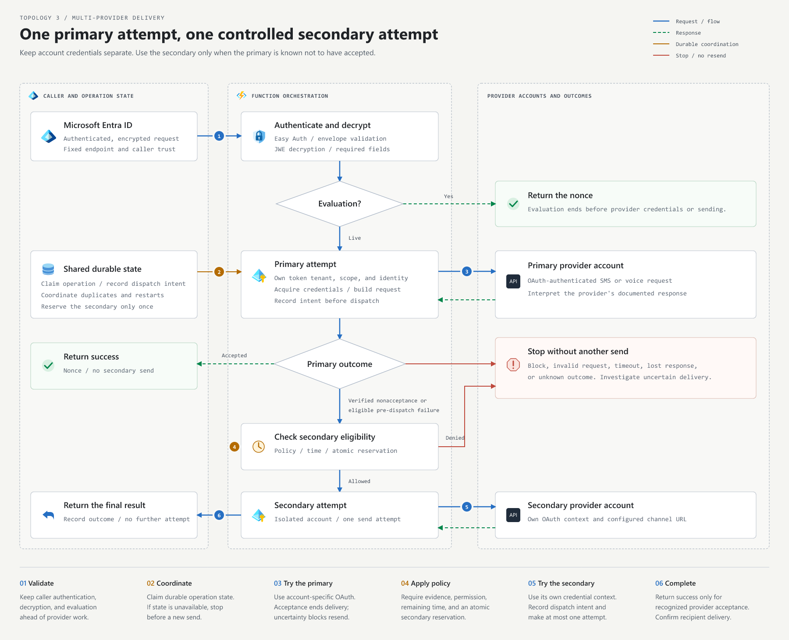

# Configure multiple phone providers

[Documentation](README.md) | [Provider adapters](BRING-YOUR-OWN-PROVIDER.md) | [HTTP contract](CONTRACT.md)

Configure a primary and secondary provider for each delivery channel. Send through the primary
first, and use the secondary only when the primary is known not to have accepted the request.

Complete [provider authorization and endpoint validation](ONBOARDING.md#complete-provider-authentication)
for each account before enabling the combined flow.

## Delivery flow

[Open the full-size diagram](images/multi-provider-flow.svg).
The secondary is considered only after a verified nonacceptance or an eligible failure before
dispatch. A timeout or lost response follows the stop path.

## 1. Define the routing policy

Record the primary account, secondary account, supported channels, destination coverage, and
conditions that allow a secondary attempt. Keep the policy in trusted deployment configuration.

Use these decision rules:

| Primary outcome | Action |
| --- | --- |
| Accepted, queued, or pending | Return the accepted result. Stop sending. |
| Explicit fraud or policy block | Return the blocked result. Do not bypass the block through another provider. |
| Invalid caller, recipient, or request | Return the appropriate error. |
| Timeout, lost response, network error after dispatch, or unknown response | Treat the outcome as uncertain. Investigate before sending again. |
| Primary-only credential failure before dispatch | Consider the secondary only if your policy allows it and the request has enough time remaining. |
| Provider-documented proof that the primary did not accept the request | Consider the secondary only under the reviewed policy. |
| Generic HTTP error or `Fail` result | Require more specific evidence of nonacceptance before considering the secondary. |

Allow at most one secondary attempt. Keep caller authentication and provider risk decisions
effective throughout the flow.

## 2. Configure and authorize both accounts

Create an independent configuration for each provider account:

| Value | Use |
| --- | --- |
| Account identifier | Stable internal name for routing and safe diagnostic correlation |
| Provider adapter | A registered adapter such as `infobip`, `soprano`, or `telesign` |
| Channel endpoints | Complete HTTPS SMS and voice URLs for that account |
| OAuth token tenant and scope | Provider-approved token issuer and API resource |
| Customer application client ID | Application authorized by the provider |
| Outbound managed identity | Identity authorized to obtain the client assertion |

Use the existing [provider profiles](../setup/providers/catalog.json) and
[runtime settings](../TECHNICAL.md#configure-environment-variables) to map these values.
All bundled providers use OAuth through managed identity federation.

1. Confirm sender configuration, destinations, channels, account limits, and pricing with each provider.
2. Complete federation and provider-side authorization for each account.
3. Load and validate both configurations at startup, including endpoint URLs and required OAuth values.
4. Keep each configuration immutable and pass it to the matching adapter and credential service.

Keep process-wide environment settings fixed while requests are running. Request fields must
not supply provider URLs, credentials, or account configuration.

Map the configuration separately for each account:

| Account value | Runtime setting |
| --- | --- |
| Adapter ID | `EPP_PROVIDER_NAME` |
| OAuth | `EPP_PROVIDER_AUTH_MODE=oauth` |
| SMS and voice URLs | `EPP_PROVIDER_SMS_ENDPOINT`, `EPP_PROVIDER_VOICE_ENDPOINT` |
| Token tenant and resource | `EPP_PROVIDER_TENANT_ID`, `EPP_PROVIDER_SCOPE` |
| Authorized application | `EPP_OUTBOUND_CLIENT_ID` |
| Outbound identity | `EPP_OUTBOUND_MI_CLIENT_ID` |

Pass these account-specific settings to `readConfig(settings)` in JavaScript,
`AppConfig.Read(IEnv)` in C#, or `read_config(env)` in Python. Use a distinct credential context
for each account even when both use the same provider adapter.

## 3. Isolate credentials by account

Give each account its own long-lived credential context. Reuse SDK clients within that context
and let Azure Identity manage token caching and renewal.

| Runtime | Integration points |
| --- | --- |
| JavaScript | Use a separate `CredentialTokenService` from [credentials.js](../javascript/src/functions/credentials.js) for each account; connect the contexts to [SendOtp.js](../javascript/src/functions/SendOtp.js). |
| C# | Give each account its own provider and OAuth credential context; register them in [Program.cs](../dotnet/Program.cs) and select the context in [SendOtp.cs](../dotnet/Functions/SendOtp.cs). |
| Python | Use a separate credential service from [credentials.py](../python/src/credentials.py) for each account and select the context in [function_app.py](../python/function_app.py). |

Attach the required managed identities to the Function App and authorize each identity for its
intended application and provider. Keep tokens tied to their account, tenant, and scope.
Close all credential contexts during shutdown and rebuild them after configuration changes.

## 4. Track attempts durably

Agree on a stable operation identifier with the caller and bind it to the authenticated request
and routing policy. Correlation IDs and Function invocation IDs serve tracing purposes; verify
their lifecycle before using an identifier for duplicate protection.

Use a shared durable store to:

1. Atomically claim the operation before sending.
2. Record dispatch intent before entering the primary provider's HTTP transport.
3. Record the outcome as accepted, blocked, failed before dispatch, verified nonacceptance, or uncertain.
4. Reserve a secondary attempt atomically only when the routing policy permits it.
5. Record the secondary dispatch intent and final outcome.

Concurrent requests and worker restarts must respect the same state. Reuse the recorded outcome
for repeat requests rather than sending another message. Keep unresolved dispatches blocked from
automatic resend, including after a timeout or expired worker lease.

Record intent and outcomes using conditional writes against the expected operation state/version.
Recheck ownership before dispatch so a stale worker cannot send after another worker has taken
over. After an uncertain attempt, preserve its state for reconciliation rather than treating an
expired lease as permission to resend.

If the store is unavailable, stop before a new send. Retain only the operation identifier,
safe account references, attempt state, and timestamps; exclude OTPs, phone data, credentials,
and request bodies. Coordinate retention with the caller's retry window.

## 5. Add the provider orchestration

Keep the shared request flow in this order:

1. Validate the caller through Easy Auth.
2. Validate the envelope, decrypt the delivery context, and check required fields.
3. For evaluation, return the nonce before acquiring provider credentials or claiming a send operation.
4. For live delivery, claim the operation and select the primary account from the configured policy.
5. Acquire that account's credentials, build its request, and send once.
6. Record the outcome and apply the decision rules from Step 1.
7. If eligible, reserve the secondary attempt, verify the remaining time, and send once through
   the secondary account.
8. Record the final outcome and return the shared [HTTP response](CONTRACT.md#success-response).

Only recognized provider acceptance can return a live success response with the nonce.
Preserve blocked and failed outcomes when a secondary attempt is not allowed.
Keep the original inbound issuer, audience, caller allowlist, and encryption configuration.

Use explicit provider-specific nonacceptance rules rather than sending to the secondary from a
generic exception handler. A lost response can follow an accepted message.

## 6. Apply one request deadline

Set an end-to-end budget that includes validation, state-store access, credential acquisition,
provider calls, and response preparation.

Check the remaining time before each attempt and reserve time to return the response.
Keep the shared credential-acquisition and HTTP timeout limits within that budget.
Propagate cancellation through the operation; after an uncertain dispatch, record uncertainty
instead of starting another send.

Agree on retry behavior with the caller and providers. The endpoint's response describes its own
attempts; Microsoft Entra ID routing and fallback remain governed by the tenant's authentication
configuration.

## 7. Test and deploy

Extend the selected runtime's offline tests with these cases:

| Scenario | Expected result |
| --- | --- |
| Evaluation or invalid request | No provider send |
| Primary acceptance | One primary send and no secondary send |
| Primary risk block | Blocked response and no secondary send |
| Eligible failure before primary dispatch | At most one secondary send, subject to policy and deadline |
| Verified primary nonacceptance | At most one secondary send after the durable reservation |
| Timeout, lost response, or unknown outcome | No automatic secondary send |
| Concurrent duplicates or worker restart | Existing operation state prevents another dispatch |
| State-store failure or insufficient time | No new send |
| Secondary failure | Final failure; no further provider attempt |

Use fake credentials, responses, clocks, and store failures for offline tests.
Then build the [runtime package](../TECHNICAL.md#build-zips-locally), deploy to a test environment,
and verify OAuth authorization and controlled delivery through each account.

Before activation, test telemetry and rollback. Record one final request outcome plus safe
per-attempt account, stage, status, and timing fields. Keep provider acceptance separate from
recipient delivery and [exclude sensitive data](LOGGING.md).

Retain the prior package and configuration for rollback. Reconcile unresolved send attempts
before resuming traffic. If combining this design with [multi-region resiliency](MULTI-REGION-RESILIENCY.md),
use shared operation state across regions and test provider switching and regional recovery
separately.
