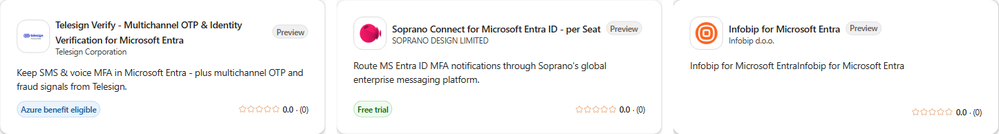
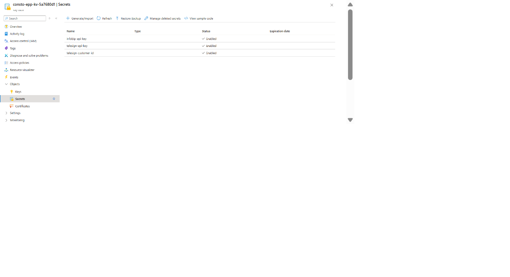
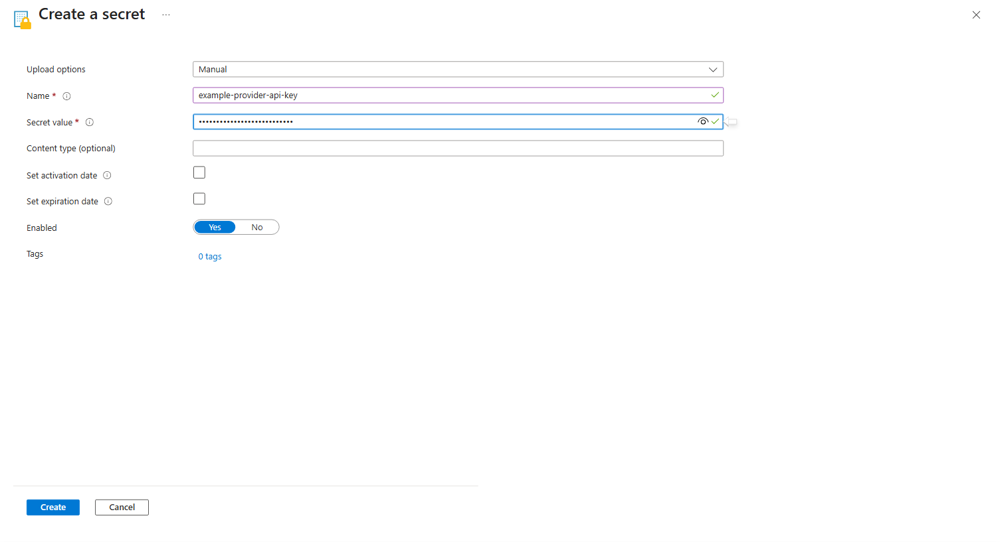

# Configure and validate the deployment

[Documentation](README.md) | [Deployment guide](GETTING-STARTED.md) | [Troubleshooting](../setup/docs/Troubleshooting.md)

After deployment, connect the provider, validate the endpoint, and assign operational owners.

| Task | Go to |
| --- | --- |
| Confirm access before spending | [Before deployment](#before-purchasing-or-deploying) |
| Gather setup values | [Values and ownership](#values-and-ownership) |
| Connect Soprano or Telesign | [Provider authentication](#complete-provider-authentication) |
| Run approved tests | [Validate the endpoint](#validate-the-deployed-endpoint) |
| Activate and assign owners | [Operations](#activate-operate-and-retire) |
| Deploy custom code | [Custom deployment](#optional-local-development-and-manual-deployment) |

<a id="before-purchasing-or-deploying"></a>
## Before deployment

In [Microsoft Security Store](https://securitystore.microsoft.com/private-solutions), confirm the
provider account, sender registration, countries, channels, pricing, and EPP access.



*Sample cards only. Check the current offer and [guided provider support](#provider-credential-names).*

Before spending or deploying, confirm:

- eligibility, licensing, and preview access
- the authorized Microsoft test caller and procedure
- the activation process
- an onboarding owner for Microsoft Entra ID, Azure, provider access, and support

Azure subscription ownership does not grant EPP access. Use the offer's support route or Microsoft
support when access is missing.

Before live use, review [production readiness](../TECHNICAL.md#production-readiness), including
delivery evidence, retry and duplicate-send handling, deadlines, monitoring, and certificate
renewal.

## Values and ownership

<a id="inputs-you-supply-to-setup"></a>
### Values you provide

| Input | Source | Setup option |
| --- | --- | --- |
| Customer tenant ID | Microsoft Entra admin center > Overview | `-TenantId` |
| Azure subscription ID | Azure portal > Subscriptions | `-SubscriptionId` |
| Endpoint application client ID | Microsoft Entra admin center > App registrations > application > Overview | `-ApplicationId` |
| Azure region | Available Linux FC1/EP1 region that meets quota and organization requirements | `-Location` |
| Provider | Approved Security Store integration | `-Provider telesign` or `soprano` |
| Provider route | Provider-confirmed Global or EU route | `-EndpointRegion global` or `eu` |
| Runtime and plan | JavaScript, .NET, or Python with FC1 or EP1 | `-Language`, `-ServicePlan` |
| Resource prefix | Unique 2-8 character lowercase label that starts with a letter | `-ResourcePrefix` |
| Encryption certificate | Existing registered key or approved replacement | `-CertificateAction` and certificate options |
| Output and source versions | Private output folder and reviewed source/release versions | Optional output and version options |

Use the application **client ID**, not its Object ID. The customer tenant ID and provider tenant ID
are different values. Global or EU selects provider routing, not Azure location or data residency.

One guided deployment uses one provider and supports both SMS and voice. Each request selects its
channel. Reusing the same subscription, application, and prefix reconfigures that deployment.

See the [setup reference](../setup/docs/README.md#prerequisites-for-step-2) for complete parameters
and [certificate selection](../setup/docs/README.md#encryption-certificate-selection).

<a id="values-setup-configures-for-you"></a>
<a id="setup-script-compatibility"></a>
### Values setup configures

Keep `deployment-*.json` and the public certificate in private storage. Compare the summary with
the approved plan. `policyChanged: false` is expected because setup does not activate policy.

| Setting | Purpose | Check |
| --- | --- | --- |
| `EPP_PROVIDER_NAME` | Selects the registered adapter | Matches the approved provider |
| `EPP_PROVIDER_SMS_ENDPOINT`, `EPP_PROVIDER_VOICE_ENDPOINT` | Channel-specific provider URLs | Provider confirms access to each channel |
| `EPP_PROVIDER_ENDPOINT_REGION` | Provider route label | Matches Global or EU selection |
| `EPP_PROVIDER_AUTH_MODE` | `apiKey` for Telesign or `oauth` for Soprano | Matches the selected profile |
| `EPP_PROVIDER_TENANT_ID`, `EPP_PROVIDER_APP_ID`, `EPP_PROVIDER_SCOPE` | Soprano API tenant, app, and scope | Provider administrator confirms exact values |
| `EPP_OUTBOUND_CLIENT_ID`, `EPP_OUTBOUND_MI_CLIENT_ID` | Customer app and outbound identity used for Soprano federation | Do not substitute object IDs |
| `KEY_VAULT_URL` | Vault holding API-key provider credentials | Use the summary's vault URI |
| `EPP_DECRYPTION_KEY_PEM`, `EPP_ENCRYPTION_KEY_ID` | Versioned encryption key reference and registered key ID | Assign a renewal owner |
| `EPP_PROVIDER_TIMEOUT_MS`, `EPP_PROVIDER_RETRY_INTERVAL_MS` | Provider timing values | Retry interval metadata does not enable retries |
| Easy Auth issuer, audience, and caller allowlist | Inbound Microsoft caller validation | Read back the platform configuration |

The trust paths are separate:

- Easy Auth validates the caller.
- The Key Vault certificate decrypts the request.
- Provider credentials authorize the outbound delivery call.

Settings select code that already exists. They do not install a provider adapter.

<a id="complete-provider-authentication"></a>
<a id="provider-credential-names"></a>
## Provider authentication

Guided setup supports **Soprano and Telesign**.

| Provider | Authentication | Customer action |
| --- | --- | --- |
| Soprano | OAuth client assertion through managed identity federation | Complete provider-side authorization and confirm tenant, app, scope, account, and channels |
| Telesign | Basic authentication from Key Vault secrets | Add `telesign-api-key` and `telesign-customer-id` to the setup-created vault |

Infobip and Sinch adapters are bundled but do not have guided setup profiles. Twilio requires the
[Add Twilio](BRING-YOUR-OWN-PROVIDER.md) development process.

<a id="where-to-enter-api-key-credentials-in-key-vault"></a>
### Add Telesign secrets

1. In the deployment summary, find `resources.keyVault`.
2. Open that vault in **Azure portal > Key vaults**.
3. Select **Objects > Secrets > Generate/Import**.

   

4. Create `telesign-api-key` with the raw API key.
5. Create `telesign-customer-id` with the matching raw Customer ID.
6. Verify both secret names, enabled state, dates, and versions without viewing their values.
7. Confirm the Function's system-assigned identity has **Key Vault Secrets User**.



*The screenshots contain test examples and fake values.*

Do not encode the credential pair or enter an Authorization header. The adapter builds Basic
authentication. Keep credentials out of commands, transcripts, settings, screenshots, and chat.

<a id="telesign-enter-and-verify-the-two-vault-secrets"></a>
During rotation, coordinate both values and their provider validity window. Verify an approved live
test before retiring the old pair. Evaluation does not test provider credentials.

<a id="soprano-provider-administrator-handoff"></a>
### Complete Soprano authorization

Setup creates the customer-side federation. The Soprano administrator still needs to authorize the
customer application and account.

Send identifiers only through the approved onboarding route:

- customer tenant ID
- endpoint application client ID
- intended channels and provider URLs
- `EPP_PROVIDER_TENANT_ID`, `EPP_PROVIDER_APP_ID`, and `EPP_PROVIDER_SCOPE`
- outbound identity client ID and principal ID when troubleshooting federation
- provider-requested account or sender reference

Keep assertions, access tokens, private keys, and client secrets private.

Ask the provider administrator to confirm the tenant, app, scope, consent or app roles, and account
access. Then inspect **App registrations > Certificates & secrets > Federated credentials**:

- issuer is the customer tenant-specific v2 issuer
- subject is the outbound identity's **Principal ID**
- audience is `api://AzureADTokenExchange`

The identity client ID is not the federation subject. Customer-side configuration alone does not
prove provider-side authorization. Verify the integration with an approved controlled live test.

<a id="validate-the-deployed-endpoint"></a>
<a id="4-package-deploy-and-verify"></a>
## Validate the endpoint

Use Microsoft's approved caller and test procedure. A customer test application or ordinary Azure
CLI token is a different caller.

Provide the authorized operator:

- endpoint URL
- customer tenant ID
- endpoint application client ID and identifier URI
- encryption key ID and public certificate or thumbprint
- selected provider and channels
- approved test window and controlled recipients

| Order | Check | Safe evidence |
| --- | --- | --- |
| 1 | Read back HTTPS and Easy Auth issuer, audience, caller allowlist, and excluded paths | Resource ID, UTC time, and configuration review |
| 2 | Send a request without a token | Expected `401` on the default single-region configuration |
| 3 | Confirm invalid, expired, wrong-issuer, wrong-audience, and unauthorized callers fail | Status and safe request identifiers |
| 4 | Send a valid encrypted evaluation request | `200`, matching nonce confirmed locally, latency, and correlated events |
| 5 | Send one approved live SMS and voice request | Provider acceptance plus separate recipient confirmation |
| 6 | Confirm logs and notifications | Saved query, resource scope, and tested action group |

The following check sends no token and no OTP:

```powershell
$endpoint = 'https://<function-host>/api/SendOtp'
$response = Invoke-WebRequest -Uri $endpoint -Method Post -ContentType 'application/json' `
    -Body '{}' -SkipHttpErrorCheck -MaximumRedirection 0 -TimeoutSec 30
$response.StatusCode
```

Expect `401` for the default Easy Auth configuration. Investigate `403`, redirects, transport
errors, `200`, or handler `400` results. This checks only the missing-token case.

Evaluation validates the authorized encrypted request path without sending a message. It does not
validate provider credentials, provider acceptance, or recipient delivery. For live requests,
`200` means provider acceptance. Confirm delivery separately and do not blindly retry timeouts.

Repeat deployed checks after package, authentication, credential, key, or routing changes.

<a id="activate-operate-and-retire"></a>
## Operations

After validation, have the policy administrator use the
[approved activation and rollback process](../setup/docs/README.md#step-3---manually-validate-and-activate-policy).
Save the prior policy, preserve unrelated properties, and read back the result.

Assign owners for:

- request failures, latency, and telemetry gaps
- provider account access and credential rotation
- certificate renewal
- alerts and incident routing
- retention and cost
- policy rollback

Setup creates telemetry resources, not alerts, action groups, availability tests, certificate
contacts, or provider delivery receipts. Keep the deployment summary, policy snapshots, validation
evidence, package version, and renewal dates in restricted operational storage.

<a id="optional-local-development-and-manual-deployment"></a>
## Custom deployment

Skip this section after guided setup unless you are changing code or deploying a custom package.

For local work:

- follow the selected [JavaScript](../javascript/README.md), [.NET](../dotnet/README.md), or
  [Python](../python/README.md) guide
- use private test settings and a local test encryption key
- keep Core Tools on loopback because it does not provide Easy Auth
- omit provider settings for evaluation-only work
- never copy production keys or credentials to a workstation

For cloud deployment, use the [package guidance](../TECHNICAL.md#download-a-function-zip).
Exclude local settings, keys, tests, and diagnostics. Apply cloud settings separately and repeat
the deployed validation checks.

<a id="2-provision-encryption-and-deployment-trust"></a>
<a id="manual-deployment-trust-checklist"></a>
### Easy Auth checklist

| Setting | Required value |
| --- | --- |
| `globalValidation.requireAuthentication` | `true` |
| `globalValidation.unauthenticatedClientAction` | `Return401` |
| `httpSettings.requireHttps` | `true` |
| `identityProviders.azureActiveDirectory.registration.clientId` | Endpoint application client ID |
| `identityProviders.azureActiveDirectory.registration.openIdIssuer` | Trusted tenant-specific issuer |
| `identityProviders.azureActiveDirectory.validation.allowedAudiences` | Exact endpoint audience |
| `identityProviders.azureActiveDirectory.validation.defaultAuthorizationPolicy.allowedApplications` | Nonempty approved Microsoft caller app-ID allowlist |
| `globalValidation.excludedPaths` | No `SendOtp` or alternate-ingress exemption |

The handler does not validate bearer tokens itself. Never use `common` or `organizations` as the
issuer, derive trust from request fields, or exempt `SendOtp`.

Keep the app registration's `tokenEncryptionKeyId` null. Microsoft Entra ID bearer-token encryption
is separate from the JWE delivery payload and is not supported by this sample.
