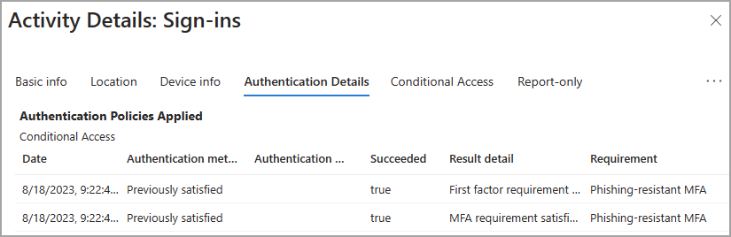
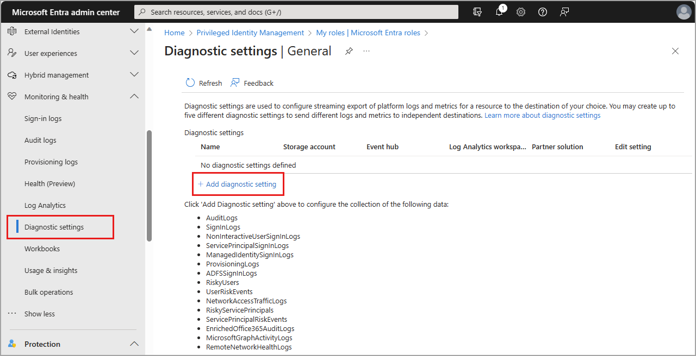

# Monitor Microsoft Entra sign-ins

Start here to look up a failed sign-in. If you also want ongoing notifications, continue
through the six steps to create your first alert. The [optional reference](#optional-reference)
covers more advanced setup and investigation.

**Sign-in logs show authentication outcomes, not OTP delivery.** A failed sign-in does not
automatically mean a phone-provider failure. Keep identity details private. EPP setup does
not export these logs or create alerts; the steps below are actions for your administrators,
not changes made by this guide.

## 1. Choose your tenant and access

1. Open the [Microsoft Entra admin center](https://entra.microsoft.com). In **Settings >
   Directories + subscriptions**, select the tenant where your users sign in. It may differ
   from the tenant hosting the Function. Note its **Tenant ID** from **Overview**.
2. Ask your tenant administrator for **Reports Reader**, the minimum role for viewing
   activity logs. See Microsoft's [access requirements](https://learn.microsoft.com/en-us/entra/identity/monitoring-health/howto-access-activity-logs#prerequisites).
   This role does not grant access to an Azure workspace.
3. Check whether you have a **workforce tenant** or an **external tenant** for customer apps.
   If unsure, use the [tenant comparison](https://learn.microsoft.com/en-us/entra/external-id/customers/concept-supported-features-customers)
   with your administrator. Both can use the portal investigation below, but external
   tenants need a different export setup in Step 3.

## 2. Find one sign-in

1. Open **Entra ID > Monitoring & health > Sign-in logs**. Choose a date range and filter
   to the application you're investigating. Open a record you're authorized to inspect.
2. In **Basic info**, check the **Application**, **Application ID**, **Resource**, outcome,
   and time. Keep the application's **client ID**, not its Object ID, for later query filters.
   This may not be the endpoint `applicationId` in your EPP deployment summary.
   The [activity-details guide](https://learn.microsoft.com/en-us/entra/identity/monitoring-health/concept-sign-in-log-activity-details#basic-info)
   explains these fields. Note the displayed time zone; use UTC when comparing other logs.
3. Open **Authentication Details** to see the methods, step outcomes, and policy context.
   Look for an interrupted challenge, policy rejection, or a step satisfied by a previous
   authentication. Microsoft's [Authentication Details explanation](https://learn.microsoft.com/en-us/entra/identity/monitoring-health/concept-sign-in-log-activity-details#authentication-details)
   helps interpret the result.

   

   *Official Microsoft Entra ID example from
   [Microsoft's activity-details instructions](https://learn.microsoft.com/en-us/entra/identity/monitoring-health/concept-sign-in-log-activity-details#authentication-details).
   [Original screenshot](https://github.com/MicrosoftDocs/entra-docs/blob/927efa819a6f89a40b39b178d702b30f49b63f00/docs/identity/monitoring-health/media/concept-sign-in-log-activity-details/sign-in-activity-details-authentication.png),
   Copyright (c) Microsoft Corporation. This is not your sign-in or a delivery test.
   Previously satisfied does not prove a new phone challenge or provider send.
   Your methods, policy results, timestamps, and portal layout can differ.*

4. Use the error code and reason with Microsoft's
   [sign-in troubleshooting guidance](https://learn.microsoft.com/en-us/entra/identity/monitoring-health/howto-troubleshoot-sign-in-errors).
   If the issue points to the endpoint or provider, follow the
   [Function monitoring guide](MONITORING.md#runtime-specific-log-discovery) separately.

**Only investigating one problem? You can stop here.** You don't need to export logs, create
a workspace, or incur additional Azure Monitor collection costs for this portal-only path.
Continue if your team wants ongoing alerts or longer-term analysis.

## 3. Export logs for ongoing monitoring

1. Agree on a workspace, region, budget, and person responsible for the alerts.
   For a **workforce tenant**, follow the
   [integration prerequisites](https://learn.microsoft.com/en-us/entra/identity/monitoring-health/howto-integrate-activity-logs-with-azure-monitor-logs#prerequisites):
   at least **Security Administrator** in Entra, an Azure subscription, a prepared workspace,
   and suitable Azure access. If needed, your Azure administrator can
   [create a workspace](https://learn.microsoft.com/en-us/azure/azure-monitor/logs/quick-create-workspace).
2. For an **external tenant**, first follow the
   [external-tenant setup instructions](https://learn.microsoft.com/en-us/entra/external-id/customers/how-to-azure-monitor#prerequisites),
   not the workforce setup above. They establish access to a workspace in a workforce
   subscription. Return here once that access is ready; [extra setup detail](#prepare-the-external-tenant-access-path)
   is available below.
3. In the **source tenant**, open **Entra ID > Monitoring & health > Diagnostic settings**.
   Check existing settings before changing them. Select **Add diagnostic setting**, or
   edit an existing setting with its maintainer's agreement.

   

   *Official Microsoft Entra admin center example from
   [Microsoft's diagnostic-settings instructions](https://learn.microsoft.com/en-us/entra/identity/monitoring-health/howto-configure-diagnostic-settings#how-to-access-diagnostic-settings).
   [Original screenshot](https://github.com/MicrosoftDocs/entra-docs/blob/927efa819a6f89a40b39b178d702b30f49b63f00/docs/identity/monitoring-health/media/howto-configure-diagnostic-settings/diagnostic-settings-start.png),
   Copyright (c) Microsoft Corporation. This is not your tenant; menus and categories vary.
   Follow the navigation above, not the example's breadcrumb. Visible risk categories do
   not establish availability or licensing in an external tenant.*

4. Name the setting and select **SignInLogs** for interactive user sign-ins. Under
   **Destination details**, select **Send to Log Analytics workspace** and choose your
   subscription and workspace. Select **Save**, reopen the setting, and check the destination.
   The [illustrated export instructions](https://learn.microsoft.com/en-us/entra/identity/monitoring-health/howto-integrate-activity-logs-with-azure-monitor-logs#send-logs-to-azure-monitor)
   show these controls.
5. Allow time for records to arrive. Initial export is not immediate and does not backfill
   all portal history. Microsoft describes about 45 minutes in its
   [External ID monitoring repository](https://github.com/microsoft/external-id-azure-monitor)
   and allows up to three days in the
   [general setup guidance](https://learn.microsoft.com/en-us/entra/identity/monitoring-health/howto-configure-diagnostic-settings#basic-process).
   These are initial setup allowances, not an ongoing latency SLA.

## 4. Check your data and choose a query

1. Open **Azure portal > Log Analytics workspaces > your workspace > Logs** with an account
   that has workspace query access, such as **Log Analytics Reader**. In **Tables**, find
   **SigninLogs**, expand its columns, and preview recent records. The
   [Logs tutorial](https://learn.microsoft.com/en-us/azure/azure-monitor/logs/log-analytics-tutorial#view-table-information)
   shows the controls using `AppRequests`; choose **SigninLogs** in your own workspace.
2. Check `AADTenantId` and `AppId` against your source tenant and app client ID.
   Compare the columns with the [SigninLogs schema](https://learn.microsoft.com/en-us/azure/azure-monitor/reference/tables/signinlogs#columns).
   No matching records is **not** a healthy result: check the destination, time range,
   category, access, and portal sign-ins before continuing.
3. Open Microsoft's [Failed Signin reasons query](https://learn.microsoft.com/en-us/azure/azure-monitor/reference/queries/signinlogs#failed-signin-reasons).
   In **KQL mode**, copy it from that source and filter to your `AADTenantId` and `AppId`
   **before summarizing**. Ask someone familiar with KQL to review the edits. Check the
   string type of `ResultType` and handle empty codes separately; these are authentication
   codes, not provider HTTP statuses. [Query adaptation details](#4-establish-the-baseline)
   explain the filters and other official query choices.
4. Choose an observation window with the receiving team, then **Run** that same calculation
   across normal, peak, and quiet periods in a representative business cycle. Read `Count`
   and the result codes, not the number of summary rows. Allow for measured ingestion delay;
   choose a failure-count threshold for that window, not a whole week's total. There is no
   universal threshold; the source query is not a turnkey EPP or fraud detector.
5. Select **Save > Save as query** and choose the agreed query pack. Saving needs
   **Log Analytics Contributor**; ask an authorized teammate if you only have read access.
   See [saving queries](https://learn.microsoft.com/en-us/azure/azure-monitor/logs/save-query).
   Keep the filters, count units, baseline, and chosen threshold with your team's setup notes.

You now have one scoped query to reuse for the first alert. Leave rate, volume, and
IP-based detection for [later](#more-alert-types), once you understand this baseline.

## 5. Create your first alert

1. Check [alert permissions](https://learn.microsoft.com/en-us/azure/azure-monitor/alerts/alerts-create-log-alert-rule#prerequisites):
   read access to the workspace, write access to the rule's resource group, and read access
   to its action group. Creating groups or assigning roles requires additional permissions.
   In **Azure portal > Monitor > Alerts > Create > Alert rule**, select your **Log Analytics
   workspace** as **Scope**, not the Function or app registration.
2. On **Condition**, choose **Custom log search**, paste the saved query, and select **Run**.
   Check **Preview**, then **Continue Editing Alert**. Follow the
   [illustrated condition instructions](https://learn.microsoft.com/en-us/azure/azure-monitor/alerts/alerts-create-log-alert-rule#configure-alert-rule-conditions).
   This is a scheduled log search alert, not an Azure Activity Log alert; check that your
   table plan supports the query and rule.
3. For **Failed Signin reasons**, set **Measure** to **Calculation of a numeric column**,
   choose `Count`, and use **Total** if you want the total across the result-code groups.
   Leave **Split by dimensions** unset for this first combined alert. Don't count summary
   rows as failures. Set **Static**, the **Operator**, and **Threshold value** from Step 4.
4. Set **Aggregation granularity (window size)** and **Frequency of evaluation** to match
   the team's observation window, ingestion delay, response needs, and budget. Review
   **Override query time range** with the query's time filter; alert scans are limited to
   **48 hours**. Start with a single violating evaluation; if you need several, review the
   [required query output and evaluation settings](#query-identity-and-rule-options) first.
   Review healthy and qualifying periods in Preview. Keep missing-data expectations separate from failure counts;
   [collection-health guidance](#monitor-ingestion-separately) explains why.
5. On **Actions**, select or create an **action group** for the receiving team. Use the
   [action-group instructions](https://learn.microsoft.com/en-us/azure/azure-monitor/alerts/action-groups#create-in-the-azure-portal)
   to configure email/push or incident routing and complete recipient verification.
   On **Details**, set the rule's name, description, severity, region, and resource group.
6. Choose the query **Identity**. For a **system-assigned managed identity**, clear
   **Enable upon creation**, create the rule disabled, and have your Azure administrator
   grant it reader/query access to the workspace. Wait for role propagation before enabling.
   An interactive query working under your account doesn't prove the rule can read logs.
   Review **Automatically resolve alerts** and [identity options](#query-identity-and-rule-options)
   before **Review + create**. Keep the rule disabled until ready for the test below.

## 6. Test, then hand over

1. Save the action group, open it, and select **Test**. Choose the notification receivers
   and wait for the result; also check that the team receives the message. Microsoft's
   [testing instructions](https://learn.microsoft.com/en-us/azure/azure-monitor/alerts/action-groups#test-an-action-group-in-the-azure-portal)
   cover failures and test permissions. This checks routing, not the sign-in query.
2. Test the query and a **temporary nonproduction rule** against existing records you're
   allowed to inspect. Use a restricted test group and a temporary condition those records
   satisfy. Check the query's window and portal override together. Verify the scheduled
   alert and its later resolution, then remove the temporary rule/settings. See the
   [full safe-test procedure](#validate-without-generating-provider-sends).
3. Don't generate live OTPs, repeated wrong codes, or production policy changes to populate
   a chart. If records are insufficient, use an approved **non-phone test sign-in** in a
   test tenant/app. An EPP evaluation does not guarantee a sign-in record or prove delivery.
4. Before enabling ongoing notifications, check that logs arrive, the rule identity has
   access, the measurement matches your baseline, and the right people receive alerts.
   Leave a teammate the query, rule, workspace, action group, settings, and support contacts.
   Arrange a check for [missing logs](#monitor-ingestion-separately), not just sign-in failures.

That's the first-alert path. These checks happen in your environment; this guide hasn't
run Azure/Kusto queries or configured your monitoring.

## Optional reference

Use these sections when you need more than the first alert: [tenant setup and access](#1-choose-the-tenant-and-permissions),
[query details](#4-establish-the-baseline), [other alert types](#more-alert-types),
[collection gaps](#monitor-ingestion-separately), [Workbooks](#6-build-a-sign-in-workbook),
and [triage, retention, and costs](#7-triage-privacy-retention-and-costs).

### Understand the evidence

1. Counts represent **stored sign-in records**, not unique customers, completed sessions,
   or sends. Several records can describe one authentication sequence. A successful sign-in
   can use an existing token claim without a phone challenge.
2. Invalid passwords, interrupted challenges, cancellation, and policy rejection can all
   cause non-success results. Neither an SMS/Voice label nor an MFA requirement identifies
   the provider. `SigninLogs` has no guaranteed EPP delivery-mode, provider-attribution,
   phone-delivery, or provider-cost field.
3. Use [Function request queries](MONITORING.md#2-single-region-function-queries) and
   [Application Insights](APPLICATION-INSIGHTS.md) for endpoint execution. Use the provider's
   delivery and billing reports for recipient delivery and charges. Evaluation and live
   Function requests can both return HTTP 200; neither proves handset receipt.

### Tenant setup, access, and licensing

1. Entra roles and Azure RBAC are separate. **Reports Reader** lets you view portal activity;
   **Security Administrator** is needed for general diagnostic settings. Review
   [workspace/table access](https://learn.microsoft.com/en-us/azure/azure-monitor/logs/manage-access)
   separately for queries. An external-tenant delegation does not grant every alert-management
   or role-assignment operation in the subscription-owning workforce tenant.
2. Check current [monitoring licensing](https://learn.microsoft.com/en-us/entra/fundamentals/licensing#microsoft-entra-monitoring-and-health):
   sign-in/audit logs are listed for Entra ID Free and P1/P2, but Graph APIs, premium reports,
   risk features, and Workbook features can have other requirements.
3. The [external-tenant feature comparison](https://learn.microsoft.com/en-us/entra/external-id/customers/concept-supported-features-customers#general-feature-comparison)
   currently lists **ID Protection as unavailable in external tenants**. Full supported
   workforce [ID Protection capabilities](https://learn.microsoft.com/en-us/entra/id-protection/overview-identity-protection#license-requirements)
   require P2 or an applicable entitlement. Don't buy workforce P2 expecting it to enable
   external-tenant risk detections.

### Prepare the external-tenant access path

1. An external tenant cannot have an associated Azure subscription. Follow the
   [illustrated wizard](https://learn.microsoft.com/en-us/entra/external-id/customers/how-to-azure-monitor#set-up-the-azure-lighthouse-configuration-in-the-wizard)
   for a workspace in a **workforce tenant** and Azure Lighthouse access. The prerequisites
   include Azure RBAC **Owner** on the subscription and **Security Administrator or
   Application Administrator** in the external tenant. Users configuring diagnostic settings
   still need **Security Administrator**.
2. If already integrated, review the destination and access rather than repeating setup.
   Otherwise select **Start set up** from external-tenant **Diagnostic settings**.
   Sign in to the workforce tenant, select subscription/resource group, and specify workspace
   name and region. In **Select user access**, choose the agreed users/groups and Azure roles.
3. Review the delegation, destination, region, permissions, and costs before **Create**.
   Wait for confirmation, select **Done**, then configure export as in Step 3.
   Don't move the EPP subscription or alter authentication policy to imitate workforce setup.

### Choose additional export categories

1. Follow the [diagnostic-settings navigation](https://learn.microsoft.com/en-us/entra/identity/monitoring-health/howto-configure-diagnostic-settings#how-to-access-diagnostic-settings)
   and [category descriptions](https://learn.microsoft.com/en-us/entra/identity/monitoring-health/concept-diagnostic-settings-logs-options)
   when expanding the first export. **AuditLogs** describes directory changes, not sign-in
   outcomes. Add it only if required.
2. Non-interactive user, service-principal, and managed-identity sign-ins use
   `AADNonInteractiveUserSignInLogs`, `AADServicePrincipalSignInLogs`, and
   `AADManagedIdentitySignInLogs`. Keep their populations/baselines separate from interactive
   `SigninLogs`. Check categories actually available in your tenant.
3. **SignInLogs** does not enable **RiskyUsers** or **UserRiskEvents**. Provider OAuth logs
   may be in the provider's tenant and need its administrator's help. Function diagnostic
   settings and Application Insights are separate pipelines, not Entra export configuration.

### Inspect schema and arrival delays

1. Check your workspace [query scope](https://learn.microsoft.com/en-us/azure/azure-monitor/logs/log-analytics-tutorial#open-log-analytics),
   not the tutorial's demo environment or Application Insights `requests`/`traces` context.
   Use [Simple mode's table selector](https://learn.microsoft.com/en-us/azure/azure-monitor/logs/log-analytics-simple-mode#get-started-in-simple-mode)
   if you prefer a point-and-click preview.
2. Expand a row using its [chevron](https://learn.microsoft.com/en-us/azure/azure-monitor/logs/log-analytics-tutorial#expand-and-sort-records).
   `AADTenantId` is the source directory; standard `TenantId` is the **workspace ID**.
   `AppId` is the app client ID, not an Object ID or provider API ID.
3. `ResultType` is a **string**: zero indicates success; populated nonzero values are
   authentication codes. Keep empty values as unknown. `CreatedDateTime` is sign-in initiation
   in UTC; `TimeGenerated` is the workspace log timestamp. They are not ingestion time.
4. Adapt the [ingestion-latency reference](https://learn.microsoft.com/en-us/azure/azure-monitor/logs/data-ingestion-time)
   and [standard-column timing guidance](https://learn.microsoft.com/en-us/azure/azure-monitor/logs/log-standard-columns#_timereceived-column)
   to your `SigninLogs` scope to measure delay, including missing timestamps.
   These generic examples are not a ready-made Entra monitor or delivery-latency measure.

### Inspect authentication steps safely

1. Compare report entries with **Authentication Details** in the portal. Token claims or
   previous authentication can satisfy a step; distinguish the step outcome from the whole sign-in.
2. Microsoft's [MFA Workbook template](https://github.com/microsoft/external-id-azure-monitor/blob/main/templates/mfaWorkbookDeployment.json)
   currently queries **AuditLogs**, not `SigninLogs` authentication-step arrays. It needs
   corresponding audit export/activity. Don't substitute tables or read it as a full step sequence.
3. A `SigninLogs` step report must handle `AuthenticationDetails` as the documented string
   containing parsed array data, with empty/invalid/missing data and nullable outcomes.
   Array expansion counts **steps**, not sign-ins. Missing steps aren't success or failure.
   Keep `authenticationMethodDetail` and raw payloads out of shared views; they can contain
   phone identifiers and other personal data.

### Adapt official queries

1. In the [SigninLogs query collection](https://learn.microsoft.com/en-us/azure/azure-monitor/reference/queries/signinlogs),
   **Failed Signin reasons** groups by code/reason; **Failed login Count** counts failures by
   resource; **Signin Locations** groups success/failure by location. Pick the measure you need.
   Some examples contain personal fields or limit MFA failures to one code; none is a
   complete CYOT/provider-failure detector.
2. Add your source tenant/app filters **before aggregation**. Use the
   [filtering tutorial](https://learn.microsoft.com/en-us/azure/azure-monitor/logs/log-analytics-tutorial#apply-multiple-query-filters)
   or [Simple mode column filters](https://learn.microsoft.com/en-us/azure/azure-monitor/logs/log-analytics-simple-mode#filter-by-column),
   then switch to KQL to check them. Results-grid searches/header filters don't persist
   as alert-query filters. Review numeric-looking code comparisons against the string schema.
3. Use the [time-range controls](https://learn.microsoft.com/en-us/azure/azure-monitor/logs/log-analytics-tutorial#set-the-query-time-range)
   with any query time filter and verify the effective range. Preview **Show** limits and
   browser-side grouping can hide data; don't mistake them for the full baseline.
4. Save the reviewed query and share its location with a teammate who has log access.
   Check that they get the same filters and columns. Distinct-user, record-count, and step
   measures differ; note unknown-code handling and any exclusions alongside the query.

### Query identity and rule options

1. Use the [scope screen](https://learn.microsoft.com/en-us/azure/azure-monitor/alerts/alerts-create-log-alert-rule#configure-the-scope-of-the-alert-rule)
   and [Details/Identity instructions](https://learn.microsoft.com/en-us/azure/azure-monitor/alerts/alerts-create-log-alert-rule#configure-alert-rule-details)
   for the workspace rule. A **user-assigned identity** needs access before selection.
   With **None**, query permissions follow the last editor. Review linked-storage policy
   and identity restrictions before choosing.
2. Measurement depends on output: **Table rows / Total** suits unsummarized matching records;
   a summarized query needs its numeric column. Sum and maximum of groups mean different things.
   A greater-than-zero row condition is only suitable when the query returns **qualifying
   incidents**, not an unconditional summary.
3. Review window, frequency, query time filter, and **Override query time range** together.
   Overlapping windows can observe records repeatedly; late arrivals can be missed.
   One-minute evaluation has query restrictions, including `ingestion_time()`.
   Multiple violations require the documented datetime output/evaluation period.
4. **Split by dimensions** creates separate series/incidents and can raise costs/expose data.
   Avoid high-cardinality IP/user/request/correlation identifiers without a specific need.
   An unsplit workspace alert is a workspace incident; put app/scope in its description/runbook.
5. In a new action group, complete **Basics**, **Notifications**, and any **Actions**, then
   **Review + create > Create**. Return to the rule and select the saved group.
   Check processing region, recipients, required verification, and **Common alert schema**
   where applicable. Keep security results restricted; don't attach automatic policy changes
   to a heuristic.
6. **Automatically resolve alerts** makes the rule stateful; resolution timing depends on
   frequency. Review **Mute actions** with the receiving team. Edit an existing rule through
   **Monitor > Alerts > Alert rules > selected rule > Edit**.

### More alert types

These are optional additions after the first count alert is working. Each needs its own
reviewed query, baseline, and response plan.

### A. Elevated non-success rate

1. Use failure counts first if they answer the question. A rate requires failures and
   total traffic for the **same tenant, app, population, and window**, with unknown-code
   handling and a minimum traffic level. The official count query does not calculate this rate.
2. Check denominator coverage in healthy and empty windows before choosing a numeric rate
   column/threshold. Document exclusions and monitor them separately. Route to authentication
   support, not automatic provider-outage classification.

### B. Unusual sign-in volume

1. Review the [authentication Workbook template](https://github.com/microsoft/external-id-azure-monitor/blob/main/templates/authenticationsWorkbookDeployment.json)
   for traffic queries, then adapt one to your scope. **User count per Application** measures
   distinct users, not sign-in record volume.
2. Choose the limit from normal traffic and response capacity. Campaigns, releases, retries,
   clients, and collection changes can explain spikes. This is not OTP-send volume,
   SMS-pumping evidence, or provider spend.

### C. Potential abuse from a source IP

1. Use [Signin Locations](https://learn.microsoft.com/en-us/azure/azure-monitor/reference/queries/signinlogs#signin-locations)
   and the [user-behavior template](https://github.com/microsoft/external-id-azure-monitor/blob/main/templates/userBehaviourWorkbookDeployment.json)
   for investigation. Neither supplies a turnkey EPP fraud alert.
2. Have security review actual `IPAddress`, `UserId`, and `ResultType` population before
   choosing a grouped rule. Account for unknown users, absent IPs, approximate distinct
   counts, distributed attempts, NAT, VPNs, mobile networks, and shared proxies.
   IP geolocation does not prove physical location.
3. Restrict personal-data results/notifications. Don't automatically block, disable an
   account/provider, or change policy solely on these heuristics.
4. In supported, licensed workforce tenants, follow
   [risk investigation instructions](https://learn.microsoft.com/en-us/entra/id-protection/howto-identity-protection-investigate-risk).
   Check populated `RiskLevelDuringSignIn`, `RiskLevelAggregated`, `RiskState`, and `RiskDetail`.
   Detections can arrive asynchronously; empty, none, or hidden isn't fraud clearance.
   A template named "risk detection" doesn't enable ID Protection in external tenants.

### Monitor ingestion separately

1. Assign someone to check collection as well as failures. See
   [missing-data guidance](https://learn.microsoft.com/en-us/azure/azure-monitor/alerts/alerts-types#log-alerts):
   quiet alerts can mean stopped export. An idle app and broken collection can look alike;
   agree on normal traffic, quiet hours, and maintenance before enabling freshness paging.
2. Compare portal sign-ins with the workspace after the measured delay. Adapt the linked
   ingestion guidance into a scoped check for **no rows, missing ingestion time, and stale
   arrival**; test each case. It is not a preconfigured no-data alert. An unresolved table
   or query error must remain visible, not become an empty-success fallback.
3. Create a separate rule with its own measure, threshold, lookback, frequency, recipient,
   and maintainer. Match the query-time override to that calculation; don't blindly use
   the aggregation window. Check the query's frequency restrictions.
4. Inspect rule health/query errors, export settings, workspace access, transformations,
   ingestion limits, and service health. Fix evaluation failures separately from stale-data
   incidents. Missing evidence doesn't mean less abuse.

### Validate without generating provider sends

1. Save the action group before **Test**. Keep the test page open until **Success** or
   **Failed**; on failure use **View details**, fix, save, and retest. Check recipient
   verification and spam filtering. Group read access alone doesn't grant test permission.
2. Compare the saved query with existing portal records in healthy, qualifying, empty,
   and delayed windows. Check output units against Measurement. For a temporary
   nonproduction rule, use records inside its lookback and a restricted test action group.
   Change the query time filter and portal override together, within the alert scan limit.
3. Authorize the test rule identity, enable it, and observe a scheduled alert and notification
   in **Monitor > Alerts**. Check resolution after the condition clears, allowing for stateful
   timing. Remove the test rule/overrides and restore the intended production settings.
4. Don't lower production thresholds for testing or route tests to production automation.
   If needed, use an approved non-phone test sign-in flow. Don't bypass Easy Auth, send live
   OTPs, induce repeated wrong codes, or alter production authentication policy.

### Build a Workbook when you need a shared view

1. Review the [Microsoft monitoring repository](https://github.com/microsoft/external-id-azure-monitor)
   and its authentication, MFA, and user-behavior templates linked above. Inspect
   **serializedData** query definitions with your query maintainer. These are ARM templates,
   not text to paste wholesale into Logs. **Deploy to Azure** can create resources/delegation;
   don't select it just to inspect a query.
2. Check tables, tenant features, personal fields, units, filters, and time settings.
   The [risk template](https://github.com/microsoft/external-id-azure-monitor/blob/main/templates/riskDetectionWorkbookDeployment.json)
   doesn't make risk features available in your tenant.
3. Open **Azure portal > Monitor > Workbooks > New**, enter **Edit**, then **Add > Add query**.
   Select **Logs (Analytics)** and your workspace. Use the reviewed query and follow
   [Workbook authoring](https://learn.microsoft.com/en-us/azure/azure-monitor/visualize/workbooks-create-workbook)
   and [Add queries](https://learn.microsoft.com/en-us/azure/azure-monitor/visualize/workbooks-create-workbook#add-queries).
   Choose a suitable **Visualization**, **Run Query**, then **Done editing**.
4. Label record/step counts clearly, explain missing data and arrival delay, and include
   freshness. Bind app/workspace/time parameters into every relevant query and test changes;
   selectors don't automatically replace hard-coded filters. Restrict detailed user/IP views.
5. **Save** to the agreed subscription/resource group/location and have a teammate check
   access. Workbook sharing doesn't grant underlying log access, create alerts, or prove
   they are enabled.

### Investigate alerts and manage the data

1. In **Monitor > Alerts > selected alert**, check the rule, workspace, app/tenant scope,
   UTC window, measured value, and rule/collection health. Open the saved query for that
   period, then the relevant Entra **Basic info**, **Authentication Details**, and policy results.
2. Separate user mistakes/interruptions, releases, and policy changes from outages or abuse.
   Escalate suspected compromise through your security response process; a heuristic isn't
   a confirmed fraud verdict.
3. For phone concerns, compare [runtime-specific Function logs](MONITORING.md#runtime-specific-log-discovery)
   and restricted provider records. `SigninLogs.CorrelationId`, Function `OperationId`,
   request IDs, and provider references are **not guaranteed equal**. Prove an association
   before joining them. No match doesn't prove no Function call; fallback can complete
   authentication through another path. Provider acceptance isn't handset receipt.
4. Keep raw identity/device/IP/phone data in approved systems. Check workspace/table access,
   Workbook sharing, and recipients. Don't put tokens, credentials, OTPs, or messages in
   alerts/public issues. Query filters are **not an access-control boundary**.
5. Review **Workspace > Tables** plan, analytics retention, and total retention using
   [retention instructions](https://learn.microsoft.com/en-us/azure/azure-monitor/logs/data-retention-configure).
   Confirm saved settings cover your investigation period; Entra portal and workspace
   retention are separate.
6. Check **Usage and estimated costs** and **Cost Management > Cost analysis** with the
   [cost guidance](https://learn.microsoft.com/en-us/azure/azure-monitor/logs/cost-logs).
   Export selects categories, not an app-only stream: query filters don't remove tenant-wide
   ingestion charges. Include retention, queries, alert frequency/dimensions, notifications,
   and separately enabled services. Provider billing is separate again.
7. Review caps/transformations with the collection maintainer; they can remove evidence
   the rules need. Keep setup notes, test results, contacts for support/security/privacy/
   retention/costs, and escalation/maintenance arrangements together. Walk a teammate through
   the query, Workbook, rule health, and test notification without sending OTPs or changing policy.
