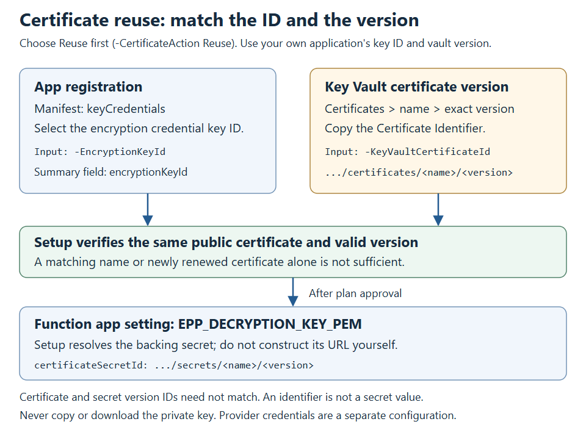

# EPP endpoint setup reference

New to the sample? Follow the [main setup guide](../../README.md). This reference explains the
permissions, hosting choices, script prompts, and maintenance steps in more detail.

The three stages in this reference are:

1. [Register a dedicated application](#step-1---manually-create-the-application).
2. [Run the setup script](#step-2---download-and-run-one-script), after checking
   [prerequisites](#prerequisites-for-step-2). It downloads its support files and deploys the
   resources and code; no repository clone or manual Bicep download is needed.
3. [Validate and activate policy](#step-3---manually-validate-and-activate-policy), with your
   onboarding owner and policy administrator. The script does not activate policy.

Confirm [provider access and the approved Microsoft procedure](../../docs/ONBOARDING.md#before-purchasing-or-deploying)
before purchasing or deploying. A provider purchase alone does not enable the tenant feature or authorize its API.

Setup creates **one endpoint in one Azure region**. For multiple regions, use the separate
[manual Front Door guide](../../docs/FRONTDOOR.md). Running setup again in another region does
not coordinate encryption keys or Front Door origins.

## Availability

Choose a **Global or EU provider route** (the prompt calls it **Tenant scope**),
**Telesign or Soprano**, and an
Azure Function **platform**: Node.js, .NET, or Python, plus a **service plan**: Flex Consumption FC1
or Premium EP1. By default, setup resolves the source repository's latest stable
`epp-packages-*` release produced by CI. A public fork's test branch can use its matching fork release.
There is no package URL or checksum to enter. Setup verifies `SHA256SUMS.txt` automatically and
performs the required build and publication for the selected language.
The Function endpoint accepts both SMS and voice; the request body's `channel` selects its provider URL.
Setup does not prompt for a channel or write a channel restriction to app settings.

Provider profiles contain complete region route objects at `deployment.routes.global` and
`deployment.routes.eu`. Each route has separate `smsEndpoint` and `voiceEndpoint` URLs plus shared
authentication and timing settings. The URLs can differ; setup always provisions both as
`EPP_PROVIDER_SMS_ENDPOINT` and `EPP_PROVIDER_VOICE_ENDPOINT`. Telesign contains its supplied
route URLs, tenant, authentication, and timings. Soprano contains its provider tenant, Global/EU
routes, API application ID, scope, authentication, and timings. The provider files contain the
complete deployment contract.

Use a Function package that supports these channel-specific settings. Both URLs are configured
explicitly; neither channel uses a shared endpoint fallback. Older packages must be upgraded.

The current profiles use identical Global/EU URLs, and Soprano uses the same app ID/scope.
This label is not proof of data residency or a choice of Azure region; confirm processing/routing
with the provider. Infobip/Sinch are bundled adapters but have no guided deployment profiles.

## Service plan selection

Setup offers these two Linux hosting plans, with the same cache app settings for every language:

| Option | Hosting | `EPP_KEY_VAULT_CACHE_ENABLED` | `EPP_ACCESS_TOKEN_CACHE_ENABLED` |
|---|---|---|---|
| 1. Flex Consumption (FC1) | On-demand with a free usage grant; zero always-ready instances, 2048 MB, up to 40 on-demand instances | `"false"` | `"false"` |
| 2. Premium (EP1) | Existing Premium configuration with one warm instance | `"true"` | `"true"` |

**FC1 is not an always-free deployment.** Its on-demand compute has a
[free usage grant](https://learn.microsoft.com/azure/azure-functions/flex-consumption-plan#billing);
usage beyond the grant, Key Vault, storage, telemetry, and provider services can incur charges.
FC1 can scale to zero and cold-start; these settings do not remove cold-start latency or force a
new worker on every invocation.

EP1 allocates paid warm capacity even without OTP traffic. Set an Azure Cost Management budget
and notify the resource owner; a budget notification does not stop spending. Include storage,
Key Vault, telemetry ingestion/retention, and the provider's charges, not just Function executions.
Stopping a Function does not necessarily stop its plan or supporting-service charges.

**Deploy a Function package that supports these switches.** Older packages ignore them.
Each switch independently controls its provider credential cache; unset defaults to `true`.
With the selected cache disabled, live requests acquire credentials on demand without startup
preparation, polling, or cross-request reuse. Values must be trimmed, case-insensitive `true` or
`false`; restart after edits. Rerunning setup restores the selected plan's values.
The decryption-key Key Vault reference remains platform-managed.

Use `-ServicePlan FC1` or `-ServicePlan EP1` to skip the prompt. Unattended setup requires this
parameter; it never silently chooses a paid plan. The approval and deployment summary include
the selected plan and both cache settings.

**Use a different resource prefix to change plans.** In-place FC1/EP1 migration is not supported.
Preflight rejects a mismatch with the existing resource-group tag or actual hosting-plan SKU,
including older EP1 deployments without the new tag. Existing EP1 deployments can be rerun with
`-ServicePlan EP1`.
For an active endpoint, onboard a new dedicated Step 1 application as well, or coordinate an
encryption-key continuity migration with its owner. A new prefix creates a new vault, but reuse of
the application still requires an explicit certificate decision. Select the existing certificate
and its Key Vault location to retain key continuity; replacement affects all endpoints sharing the
application. Setup does not automatically migrate keys or activate the replacement endpoint.

## Step 1 - manually create the application

Use a dedicated nonproduction tenant/subscription for the first deployment.

1. In the customer tenant's **Microsoft Entra admin center > App registrations**, register a
   dedicated application with **Accounts in this organizational directory only** as its initial
   supported account type; setup changes it to organizational multi-tenant after approval.
   No redirect URI, client secret, API permission, app role,
   or enterprise-application configuration is required manually.
2. Record the **Directory (tenant) ID** and **Application (client) ID**. The script requires the
   client ID, not the application's object ID, and will not create a replacement registration.
3. Complete provider purchase and account/sender registration, and arrange API onboarding for the selected adapter.
   Telesign uses `telesign-api-key` and `telesign-customer-id` in Key Vault. Soprano uses OAuth
   client-assertion exchange with the selected provider tenant/scope/application ID. Setup does not
   grant provider API consent or application roles. Finish the
   [provider authentication handoff](../../docs/ONBOARDING.md#complete-provider-authentication)
   after setup creates the vault and identity identifiers needed for those steps.

After the single Step 2 approval, PowerShell makes the dedicated app organizational multi-tenant,
restricts it through the Entra allowed-tenants preview to its home tenant plus the selected provider
tenant from the provider JSON, preserving any existing allowed provider tenants,
adds the `Epp.Invoke` application permission, creates/reuses its enterprise application, requires
assignment, creates/reuses the Microsoft phone-provider service principal, and assigns `Epp.Invoke`.
It also grants that Microsoft service principal tenant-wide Microsoft Graph `Application.Read.All`,
adds the hostname-based identifier URI and public JWE encryption certificate, and configures Easy
Auth to allow only the Microsoft phone-provider application. Soprano additionally creates the
disclosed outbound managed-identity federated credential.

## Prerequisites for Step 2

- **Azure Cloud Shell in PowerShell mode, or PowerShell 7+** with an Azure CLI user login.
  Certificate issuance happens inside Key Vault without local certificate-store cmdlets.
- Azure CLI **2.60.0+ for FC1** or **2.48.1+ for EP1** on `PATH`, with access to GitHub, Azure, Microsoft Graph, and Key Vault.
  Setup installs the Azure CLI Bicep component after confirmation when it is missing. Azure CLI itself
  must be installed before running the script. FC1 publication and EP1 Python builds also need
  network access to SCM.
- An Azure **user** account permitted to deploy at subscription scope, create the listed resources,
  and create the scoped Azure role assignments. Bicep grants the operator **Key Vault Certificates
  Officer** for issuance and **Key Vault Secrets Officer** for provider credentials,
  scoped to this deployment's vault.
- **Certificate reuse:** the operator needs ARM read access to the source vault, certificate-read
  access, and secret-version metadata-read access before approval. For a different vault, the
  approved plan also requires permission to grant the Function identity secret-read access:
  role-assignment write for RBAC vaults, or access-policy write for access-policy vaults.
  The source vault must be in the customer tenant; `-KeyVaultSubscriptionId` identifies a
  different source subscription. Setup never fetches its private-key value locally.
- A Microsoft Entra **Privileged Role Administrator** for granting the Microsoft first-party service
  principal Graph `Application.Read.All`. Microsoft Graph operations use the current Azure CLI
  user session through `az ad` and `az rest`; Azure subscription roles alone do not grant these
  directory permissions.
- Microsoft Graph **beta** access for the Entra `signInAudienceRestrictions` allowed-tenants preview.
  The selected provider tenant is allowed in addition to the app's home tenant, which Entra always allows.
  See the [allowed-tenants schema](https://learn.microsoft.com/en-us/graph/api/resources/allowedtenantsaudience?view=graph-rest-beta).
- The selected **Linux Flex Consumption FC1 or Premium EP1** plan available in the chosen region,
  with sufficient subscription quota. Availability is checked for that plan only; regional service
  availability and resource-provider registration do not guarantee quota. If deployment reports
  `SubscriptionIsOverQuotaForSku`, resolve the
  [regional quota issue](Troubleshooting.md#deployment-fails-with-subscriptionisoverquotaforsku)
  before retrying. Setup registers missing required Azure
  resource providers automatically after the single approval. The Azure account needs the
  providers' subscription-scoped `/register/action` permission (included in Contributor/Owner).
- **.NET selection only:** install the .NET 8 SDK and allow NuGet access. Setup runs `dotnet publish`
  automatically for `linux-x64`, packages the publish output, and deploys it. No manual build step
  or upload is required. JavaScript and Python do not require this SDK.
- **Python selection:** Azure performs the Linux dependency build. No local Python, pip, or Windows
  dependency installation is needed. The source archive is never used directly as run-from-package.

### Permissions are separate

For an Azure built-in-role example, **Owner at the selected subscription** includes deployment,
resource-provider registration, and role-assignment rights. **Contributor alone is insufficient**
for `Microsoft.Authorization/roleAssignments/write`; Contributor plus **Role Based Access Control
Administrator** at the required scope is another administrator-reviewed option, subject to any
role-assignment conditions. Setup deploys at subscription scope and creates a new resource group;
a role on an unrelated existing group is not sufficient. Request only approved scope/duration
and activate eligible PIM roles before setup. See [Azure roles](https://learn.microsoft.com/azure/role-based-access-control/built-in-roles).

Azure roles do not grant Entra/Graph permissions, and Entra roles do not grant Azure/vault access.
The Entra Privileged Role Administrator and directory permissions of the signed-in Azure CLI user
above are for setup.
The later Authentication Policy Administrator and policy permissions are a **separate activation**
step. Setup grants vault data roles to its Azure operator and Function identity; it does not
automatically grant them to every member of your operations team.

### Install and check workstation tools

Use the official [PowerShell installation](https://learn.microsoft.com/powershell/scripting/install/installing-powershell),
[Azure CLI installation](https://learn.microsoft.com/cli/azure/install-azure-cli), and
[.NET 8 SDK download](https://dotnet.microsoft.com/download/dotnet/8.0) instructions (SDK only for C#).
Open a new **PowerShell 7** window after installation, then check:

```powershell
$PSVersionTable.PSVersion
az version
# Only when choosing dotnet:
dotnet --list-sdks
```

Missing Bicep can be installed by interactive setup after confirmation.
These version checks do not establish Azure permissions, quota, feature availability, or provider access.

| Choice | Azure runtime | Automatic deployment path |
|---|---|---|
| JavaScript | Node.js 22, Functions v4 | Verify and publish the ready ZIP with its production dependencies |
| .NET | .NET 8 isolated, Functions v4 | Verify source ZIP, publish for Linux with .NET 8, repackage and publish |
| Python | Python 3.11, Functions v4 | Verify source ZIP; One Deploy with remote build on FC1, or validate/download and publish the SCM-built output on EP1 |

Package hashes are still checked; removing the **customer prompt** does not disable integrity
verification. Source and deployed-package hashes are recorded separately when a build changes the bytes.
For FC1 Python, One Deploy builds and stores the output inside Azure; the summary records the
verified source hash and leaves `packageSha256` null rather than reporting it as the built-output hash.

Setup normally detects these automatically. For noninteractive execution, preinstall prerequisites
or explicitly allow Bicep installation with `-InstallPrerequisites`; see the
[complete example](#noninteractive-example).

Install Azure CLI through its official installation instructions if necessary. Setup starts by
reading cached enabled user subscriptions without changing the CLI default. You can select a
tenant and subscription, refresh the cache, or explicitly start device-code sign-in. Microsoft
Graph uses the resulting CLI directory through `az ad` and `az rest`; there is no separate Graph
PowerShell sign-in. Authentication, Bicep installation, MFA, and administrator-consent prompts
are not resource-creation approvals.

Use `-ForceAuthentication` when the machine has ambiguous cached identities. It requires interactive
Azure CLI device-code authentication, does not clear shared token caches, and cannot be combined
with `-NonInteractive`. Azure RBAC uses the selected ARM token's validated `oid`; Graph user
readback comes from the same CLI directory session.

## Step 2 - download and run one script

Download [Setup-Epp.ps1](../Setup-Epp.ps1) from the upstream raw URL:

```powershell
Invoke-WebRequest `
    -Uri 'https://raw.githubusercontent.com/Azure-Samples/ExternalPhoneProvider-AzureFunction-Sample/main/setup/Setup-Epp.ps1' `
    -OutFile .\Setup-Epp.ps1
```

Review the downloaded script before running it:

```powershell
.\Setup-Epp.ps1
```

Force explicit account selection when testing on a shared or multi-account computer:

```powershell
.\Setup-Epp.ps1 -ForceAuthentication
```

The flow is:

1. **Choose the customer Azure context.** Setup lists cached enabled Azure CLI user subscriptions,
   then asks for the tenant and subscription. Refresh or start device-code sign-in when the
   expected account is missing. Explicit `-TenantId` and `-SubscriptionId` values are preserved.
2. **Choose the dedicated app registration and Azure region.** The application picker shows
   organizational app names and client IDs, supports bounded name-prefix search and manual client-ID
   entry, and never substitutes an object ID. The region picker uses Azure's current Recommended
   metadata for a short list, with all-physical-region and manual-entry options. Supplied values
   skip these selectors.
3. **Choose the Global or EU provider route** (shown as **Tenant scope**).
4. **Choose a provider by name**, then an Azure Function **platform**: Node.js, .NET, or Python.
   When `-Provider` is omitted, setup reads the application's allowed-tenants configuration:
   no supported provider prompts for a name, one asks for confirmation, and several require a
   name. Existing allowed provider tenants are preserved; provider options are never numbered.
   Setup downloads the provider JSON,
   resolves one complete regional route containing both SMS and voice endpoints, authentication, app-ID/scope
   when applicable, timeout, and retry interval. These values come from the selected profile;
   the launcher has no endpoint or credential override parameters. It also resolves the latest stable CI package
   release and looks up the language asset name in `packages/catalog.json`; there are no
   `PackageUrl` or `PackageSha256` inputs. Use
   `-PackageReleaseTag epp-packages-<run>-<attempt>` to pin a previous CI release. Malformed or
   disabled profiles still fail before resource creation.
5. **Service plan selection:** choose **Flex Consumption FC1** (free usage grant, zero always-ready
   instances, both cache settings `"false"`) or **Premium EP1** (warm instance, both cache settings `"true"`).
   Supply `-ServicePlan FC1` or `-ServicePlan EP1` to reuse a known selection.
6. **Enter a resource prefix**, such as `contoso`. All resources created by the script start with
   this prefix. Use 2-8 lowercase letters or digits, starting with a letter. Every top-level
   resource name then adds the meaningful `epp` marker, for example
   `contoso-epp-rg-<suffix>`. A deterministic suffix derived from the
   subscription, application ID, and prefix reduces global-name collisions. Reruns use the same names.
7. **Check prerequisites and revalidate authentication.** Missing Bicep can be installed after a
   separate confirmation. Graph operations reuse the selected Azure CLI user session; no Graph
   SDK installation or separate sign-in occurs.
8. **Choose encryption certificate handling.** With no registered encryption certificate, use the
   normal creation flow. Otherwise choose reuse of one certificate and supply its versioned Key
   Vault location, or replace all encryption credentials with one new certificate. Reuse of one
   among several also removes the others after approval. Enter cancels the certificate decision.
9. **Review the complete plan**, including resource names, tenant/subscription, language, service plan,
   both cache settings, automatic package verification/build, provider
   settings, scoped roles, the exact encryption key IDs to keep/remove, certificate location or
   staging name, and application configuration. Bicep receives these
   exact names; it does not independently calculate a different naming scheme.
   The plan also lists the six required **Azure resource providers** and their registration states.
   These Azure service registrations are separate from your phone-provider selection.
10. **Type `Yes` once to deploy.** `No` or Enter cancels without Azure changes. Invalid answers prompt
   again; individual resources do not request additional approvals.

### Encryption certificate selection

Setup reads `keyCredentials` before deployment and identifies **`type=AsymmetricX509Cert`,
`usage=Encrypt`** entries, including expired entries. `Encrypt` is the usage, not the type.
It displays each key ID, certificate thumbprint, name, and validity. Signing/verification
certificates are not encryption candidates, and unsupported encryption credential types stop setup.



*Original identifier map; [open the scalable illustration](../../docs/images/onboarding/certificate-reuse.svg).
**Reuse path only:** choose **Reuse** interactively or pass `-CertificateAction Reuse`. Select the app encryption key
and provide its certificate version; unattended reuse requires both named ID parameters.
The Function's secret reference is an output, not a secret value to copy. Follow the checks below.*

| Existing encryption credentials | Choice | Result after successful deployment |
|---|---|---|
| None | Creation is automatic; optional `-CertificateAction Create`. | Register one certificate from the setup vault. |
| One | `Reuse` and provide its Key Vault certificate version, or `Replace`. | Keep the existing key ID, or replace it with one new credential. |
| Several | `Reuse`, select the key ID to keep, and provide its certificate version; or `Replace`. | Remove only the other encryption entries, or replace all encryption entries with one new credential. |

Interactive selection never defaults to the newest certificate or to cleanup. Enter/Cancel
stops before deployment; invalid locations can be corrected or followed by another choice.
Selecting an action does not apply it: the complete deployment approval lists the exact removals.

For reuse, open **Azure portal > Key Vault > Certificates > certificate > version** and copy
**Certificate Identifier**, of the form
`https://<vault>.vault.azure.net/certificates/<name>/<version>`. A version is required.
Do not supply a vault-only URL, `/keys/` URL, public `.cer` file, secret value, or a versionless
reference. Setup reads the public certificate and resolves the corresponding **versioned backing
secret**; the certificate and secret version identifiers need not be identical.

The certificate must exactly match the selected registered certificate, not just its display
name or RSA key. It must use exportable RSA of at least 2048 bits with an enabled,
certificate-managed PEM backing secret. Both the certificate and registered credential must be
valid now with more than 30 days remaining; any secret validity restrictions must also pass.
Existing compatible subjects and display names are preserved. A renewed certificate is not
silently appended, even if it reuses the same RSA key.

The Function uses its **system-assigned identity** for the private-key reference, not the setup
operator or the outbound provider identity. For a different vault, the plan grants **Key Vault
Secrets User at the certificate secret's scope** in RBAC mode. An access-policy vault instead
receives additive **Secrets/Get** permission while retaining existing permissions; this older
model grants secret read **vault-wide**, which is disclosed in the plan. External vault network
rules and certificate issuance policies are not modified. Provide a working network path from
the Function; operator access alone does not establish Function access.

All vaults must be in the customer tenant. The source vault defaults to the deployment
subscription; supply `-KeyVaultSubscriptionId` if it is elsewhere. Provider credentials remain
in the setup-created vault selected by `KEY_VAULT_URL`, even when the encryption certificate is
reused from another vault.

**Cleanup only removes the approved application encryption credentials.** It preserves other
application credentials and does not delete Key Vault certificates, keys, or secrets.
Replacement prepares a separate `phone-provider-encryption-<suffix>` certificate first.
If a run fails before registration, retrying the same approved replacement state reuses that
staged certificate. Setup verifies the Function's secret reference before changing the
registration, then reads back exactly one matching encryption credential.

**Coordinate maintenance for active applications.** Every endpoint sharing the registration is
affected, and cached/in-flight requests can still use retired keys. This is not zero-downtime
rotation and does not implement overlapping decryption keys. Complete the authorized evaluation
before activation or returning the endpoint to service.

### Reviewing the plan without deploying

`Setup-Epp.ps1` does not implement `-DryRun`, `-WhatIf`, or PowerShell `ShouldProcess`.
To review a real plan, run interactively, complete preflight, then answer **No** or press Enter
at `Deploy this complete plan? Type Yes or No [No]`. Do not supply `-ApproveDeployment`:
that switch authorizes the deployment phase without asking again.

This is a cancellation at the approval gate, not an offline simulation. The existing application
registration is still required. Before the plan appears, setup can download tools and packages,
request prerequisite installation, sign in through Azure CLI, perform permission and
region checks, verify package checksums, build the C# package locally when selected, and compile Bicep.
Installation, sign-in, and consent prompts are separate from deployment approval.
A preflight error is not a successful preview.

### After approving the plan

After approval, setup rechecks the selected subscription and registers only missing
`Microsoft.Web`, `Microsoft.Storage`, `Microsoft.KeyVault`, `Microsoft.OperationalInsights`,
`Microsoft.Insights`, and `Microsoft.ManagedIdentity` providers. Already registered providers are
left alone; existing registrations in progress are reused. Registration and regional checks happen
before certificate creation or Bicep deployment. The read-only preflight does not register anything.

Azure registers providers region by region. Setup does not unnecessarily wait for a global
`Registered` state when a provider is already `Registering` and exposes the requested region.
Registration metadata is polled with a bounded limit, and recognized regional registration
propagation errors are retried during capability checks/deployment. Permission failures and
unsupported regions remain explicit errors. Registration is subscription-wide and isn't undone
automatically if a later deployment step fails.

Supply known values to shorten the prompts. Replace `<provider-id>` with your selected guided
provider's ID (`soprano` or `telesign`); neither is a default or recommendation:

```powershell
.\Setup-Epp.ps1 `
    -TenantId '<customer-tenant-id>' `
    -SubscriptionId '<subscription-id>' `
    -ApplicationId '<existing-client-id>' `
    -Location westus2 `
    -Language javascript `
    -ServicePlan FC1 `
    -Provider '<provider-id>' `
    -EndpointRegion global `
    -ResourcePrefix contoso
```

Replace the ID placeholders with quoted GUID strings before execution. The `-Channel` parameter
has been removed; omit it from existing setup commands. For an independent second provider
deployment, use a different prefix **and a dedicated app**.
The suffix does not include provider/region, so changing those inputs with the same
subscription/app/prefix can reconfigure the existing endpoint. See
[deployment separation and key constraints](../../docs/ONBOARDING.md#inputs-you-supply-to-setup).

The plan creates or updates a dedicated resource group, selected Linux FC1 or EP1 hosting plan, Function App,
storage account/private package container, Key Vault, Log Analytics workspace, Application Insights,
outbound managed identity, diagnostics, Easy Auth, and scoped role assignments. Storage/package
access uses managed identity, not account keys or Azure Storage shared access signatures.
Telemetry uses the system identity; the outbound identity is selected explicitly, not through
a global `AZURE_CLIENT_ID`.

The Function starts with public ingress disabled. After Bicep creates the vault and permissions,
setup applies the approved certificate action. New certificates are self-signed, exportable
RSA-2048 with subject and Entra display name **`CN=ExternalPhoneProvider`**. Initial creation uses
`phone-provider-encryption`; replacement uses a separate suffixed staging name. Reuse selects the
approved existing certificate version and preserves its registered key ID and display name.
Setup pins `EPP_DECRYPTION_KEY_PEM` to the **versioned PEM backing secret**, verifies resolution,
then writes exactly one `AsymmetricX509Cert` / `Encrypt` entry while preserving other credentials.
It **reads back and verifies Easy Auth before enabling ingress**.
SCM basic authentication stays disabled for both plans. FC1 uses Entra-authenticated **One Deploy**
for every language, with remote build for Python. Its `functionAppConfig` defines runtime, scaling,
and managed-identity deployment storage; setup does not write Premium-only runtime/build or
`WEBSITE_RUN_FROM_PACKAGE` settings. One Deploy handles publication and trigger synchronization.
EP1 Python uses the Entra-authenticated SCM remote build: setup validates the built Python payload,
stores it in private Blob storage, and switches to managed-identity run-from-package.
It never mounts the unbuilt Python source ZIP. EP1 then restarts and synchronizes triggers.
Both plans verify that `SendOtp` is registered before reporting success.
On publication/startup failure it disables public ingress again; failure to close ingress is reported
explicitly rather than hidden.
Setup refreshes and checks the exact decryption-key reference through App Service with bounded
retries for identity/role propagation. Failure to resolve it stops before changing registered
encryption credentials; infrastructure and app settings may already have changed. This metadata
check does not replace the required authorized evaluation of decryption before policy activation.

The public certificate and a timestamped identifier
summary are saved to `epp-output` beside the downloaded script, or to `-OutputDirectory`.
The summary includes certificate/secret version identifiers, thumbprint, expiry, and manual renewal
mode. Its service-plan and cache fields record configured settings, not verified runtime cache behavior.
Setup never downloads, writes, or imports the private key locally: only the Function receives
it through its managed-identity Key Vault reference. Certificate creation automatically supplies the
backing secret; setup no longer writes a separate `phone-provider-decryption-key` secret.

For unattended runs, supply every input including `-ServicePlan FC1` or `-ServicePlan EP1`,
authenticate Azure CLI for both ARM and Microsoft Graph first, and explicitly authorize
the whole displayed plan with **both** `-NonInteractive -ApproveDeployment`. `-NonInteractive`
alone never approves changes. There is no `-Stage`, `-Resume`, `-ConfigPath`, or policy-approval switch.
Existing encryption credentials also require explicit `-CertificateAction Reuse` or `Replace`.
Unattended reuse requires both `-EncryptionKeyId` and `-KeyVaultCertificateId`, even if only one
credential exists. `-ApproveDeployment` alone never selects a certificate or authorizes an
implicit replacement.

### Noninteractive example

This JavaScript deployment template supports both SMS and voice; it is not a credential script.
Replace the three application/tenant/subscription IDs and `<provider-id>` (`soprano` or `telesign`),
and choose the approved provider route, Azure region, prefix, and plan before running.
The preliminary user sign-ins can require MFA and consent; `-NonInteractive` does not create a
headless service-principal deployment path. Install Azure CLI Bicep beforehand using interactive
setup's prerequisite prompt or your approved installation process.
The `az login` step below is for local PowerShell. In Cloud Shell, start in the intended directory
and reuse its existing login instead; token checks use the selected subscription, not `--tenant`.

```powershell
$tenantId = '<customer-tenant-guid>'
$subscriptionId = '<subscription-guid>'
$applicationId = '<dedicated-app-client-guid>'

az login --tenant $tenantId
if ($LASTEXITCODE -ne 0) { throw 'Azure sign-in failed.' }
az account get-access-token --subscription $subscriptionId --output none
if ($LASTEXITCODE -ne 0) { throw 'Azure subscription token acquisition failed.' }
az account get-access-token --subscription $subscriptionId --resource-type ms-graph --output none
if ($LASTEXITCODE -ne 0) { throw 'Microsoft Graph token acquisition failed.' }

.\Setup-Epp.ps1 `
    -TenantId $tenantId `
    -SubscriptionId $subscriptionId `
    -ApplicationId $applicationId `
    -Location westus2 `
    -Provider '<provider-id>' `
    -EndpointRegion global `
    -Language javascript `
    -ServicePlan FC1 `
    -ResourcePrefix contoso `
    -OutputDirectory .\epp-output `
    -NonInteractive `
    -ApproveDeployment
```

Use `-InstallPrerequisites` only when authorizing automatic missing-dependency installation.
It installs the Azure CLI Bicep component only; the Microsoft Graph PowerShell SDK is not used.
Use the [source/version options](#source-versioning) to pin repeatable deployments.
Review the corresponding interactive plan first; `-ApproveDeployment` authorizes the complete
mutation set, not just package upload. Do not use it as a dry run.

Add `-PassThru` when automation also needs the structured deployment result. The timestamped
summary JSON is saved regardless.

The example above assumes the app has **no encryption credentials**. For a rerun, add
`@reuseCertificate` to the complete setup command using this reviewed parameter set:

```powershell
$reuseCertificate = @{
    CertificateAction = 'Reuse'
    EncryptionKeyId = '<key-id-to-keep-from-setup-or-the-app-manifest>'
    KeyVaultCertificateId = 'https://<vault>.vault.azure.net/certificates/<name>/<version>'
}
```

If necessary, also add `KeyVaultSubscriptionId` to that hashtable. For deliberate replacement,
use **`-CertificateAction Replace` instead of the reuse parameters**. This replaces all registered
encryption credentials, not just an expired one. Do not blindly rerun a replacement command after
a partial failure: inspect the current registration, and choose reuse if the new credential was
already registered.

### Read the deployment summary

Open the timestamped JSON under `epp-output` in a private editor. It contains identifiers and
configuration metadata, not provider credentials or private-key bytes. Keep it access-controlled.

| Summary field | How to use it |
|---|---|
| `tenantId`, `subscriptionId`, `applicationId` | Verify the intended customer directory, Azure subscription, and endpoint **client ID**. |
| `resources.functionApp`, `resources.keyVault`, `resources.applicationInsights`, `resources.logAnalytics` | Find the exact Azure resources; do not guess names or use a different environment's vault. |
| `provider`, `endpointRegion`, `providerTenantId` | Confirm provider routing, separate from the customer's directory and Azure location. Both SMS and voice use this configuration. |
| `allowedProviderTenantIds` | Review the complete preserved provider-tenant allowlist, including the selected provider. This does not enable runtime fallback between providers. |
| `providerSmsEndpoint`, `providerVoiceEndpoint` | Confirm the distinct or identical provider URLs for SMS and voice. These are outbound provider URLs, not the Function's `endpointUrl`. |
| `endpointUrl`, `identifierUri` | Exact SendOtp URL and registered app audience information for the authorized test/policy operator. |
| `encryptionKeyId`, `certificateThumbprint`, `certificateId`, `certificateSecretId`, `certificateExpiresUtc` | Public-key identification and version/renewal inventory. A secret **ID** is not its value; do not fetch its private-key contents. |
| `certificateAction`, `removedEncryptionKeyIds`, `certificateVaultSubscriptionId` | Review whether creation, reuse, or replacement occurred, the exact retired application key IDs, and the source certificate's subscription. |
| `certificateReferenceResolved` | `true` means the Function's exact secret reference resolved before registration. It is not proof of successful authorized decryption or provider delivery. |
| `endpointServicePrincipalId`, `microsoftPhoneProviderServicePrincipalId` | Tenant-local enterprise-application Object IDs; neither is the endpoint app client ID. |
| `source`, `sourceRevision`, `packageReleaseTag`, `packageUrl`, `sourcePackageSha256`, `packageSha256`, `language`, `servicePlan` | Commit-pinned setup source, package release provenance, and runtime/plan. FC1 Python's built hash can be null; source and built hashes describe different artifacts. |
| `policyChanged` | Expected `false`: deployment has not activated policy. |

The `provider` field must match your selected provider. For example, a record for the Global route
can contain `"endpointRegion": "global"`, `"certificateRenewal": "manual"`, and `"policyChanged": false`.
Those fields do not prove credentials, delivery, or monitoring work. Follow
[provider authentication](../../docs/ONBOARDING.md#complete-provider-authentication) next,
**even if the script's completion text does not prompt for your provider**.

### Encryption certificate lifecycle

The policy for certificates **issued by setup** uses **12-month validity, key reuse, and manual renewal**. It specifies
`EmailContacts` 30 days before expiry, **not `AutoRenew`**. Email is sent only if the customer
separately configures Key Vault certificate contacts; setup does not create contacts or guarantee
notifications. Track the saved expiry and arrange renewal before the certificate expires.

In **Key Vault > Certificates > Certificate contacts**, add the approved operations/renewal
contact and verify the address and ownership. Portal labels can vary; follow
[certificate renewal and contacts](https://learn.microsoft.com/azure/key-vault/certificates/overview-renew-certificate).
Record `certificateExpiresUtc` in your inventory and create an independent scheduled reminder
before the 30-day window, with an escalation owner. EmailContacts is not an Azure Monitor alert
rule, and setup does not test email delivery. Monitor both the vault certificate's and Entra
credential's expiration; renewing one does not renew the other automatically.

Use **Reuse** for a rerun with the exact registered certificate and its versioned Key Vault
location. Reuse never issues a certificate or adds a new credential. If there are older or duplicate
encryption entries, approve which key ID to keep and which entries to retire.

For the Create/Replace paths, only a certificate-not-found response triggers issuance. Azure CLI
waits for self-signed issuance. Other errors, including pending-operation conflicts, stop setup
rather than overwriting a disabled, incompatible, or near-expiry staged certificate. Keep more than
30 days of validity remaining. No Key Vault version is deleted as part of application cleanup.

For renewal, coordinate with the EPP owner before expiry. **Replace** stages a new certificate
and switches the single-key endpoint under the approved maintenance plan. Alternatively, use the
supported administrator procedure to synchronize a renewed certificate in Entra and Key Vault,
then select that exact registered version with **Reuse**. Rerunning setup no longer appends a
renewed certificate alongside older credentials, even when it has the same RSA key.

Key Vault renewal alone does **not** update Entra or the Function's pinned reference.
Reuse does not change an external certificate's issuance/renewal policy. Even if that vault
automatically issues a new version, endpoint synchronization remains manual; this is what the
summary's `certificateRenewal: manual` records. The Function still decrypts in-process with a
single private key, so any rotation must account for other endpoints and cached/in-flight requests.

**Legacy deployments require an explicit decision.** A compatible matching Key Vault certificate
can be reused even if it has an older/custom subject. A standalone PEM secret without a Key Vault
certificate is not a reuse input: arrange an approved secure certificate import with a PEM backing
secret, or choose replacement. Setup never exports the private key locally. Do not manually delete
registered credentials merely to bypass the selection or matching checks.

Setup rechecks the application credentials against the reviewed plan before changing them.
Detected credential changes stop the run and require a new review; this is not an atomic lock.
Do not run setup concurrently against the same application. A failure after approval may
leave provisioned resources or changed app settings even when no encryption credentials were removed;
follow [safe recovery](Troubleshooting.md#recover-without-destructive-cleanup).

### Source versioning

**For developers testing unpublished changes:** publish to a public fork with a matching stable
package release, then use `-SourceRepository <owner/repository>` and
`-SourceRef <branch-or-full-commit-sha>`. Both must identify the same source as the downloaded
launcher. Use `-PackageReleaseTag` if the fork contains more than one stable package release.
Unpublished worktree changes are not downloadable from GitHub.

`-SourceRepository` defaults to `Azure-Samples/ExternalPhoneProvider-AzureFunction-Sample`.
The small entry point resolves `-SourceRef` (default `main`) to a single commit in that repository. All supporting
PowerShell, Bicep, both catalogs, and every catalog-listed provider profile are downloaded from that commit.
The package catalog supplies asset names, while setup resolves the latest stable `epp-packages-*`
release from the same repository and verifies the selected asset against that release's
`SHA256SUMS.txt`. The plan and saved summary record the concrete versioned URL and hashes.
For a fully repeatable deployment, use both a reviewed full commit SHA and
`-PackageReleaseTag epp-packages-<run>-<attempt>`. Provider JSON selects data only; it cannot
redirect execution to another script. Download failures stop setup, and temporary downloads are
removed on completion or failure. Select only a repository whose code you trust: its supporting
PowerShell is executed locally.

### Offline setup checks

From the repository root, compile the infrastructure and run all setup regression suites without
Azure sign-in or resource changes:

```powershell
$templatePath = Join-Path ([IO.Path]::GetTempPath()) "epp-main-$([Guid]::NewGuid().ToString('N')).json"
az bicep build --file .\setup\infra\main.bicep --outfile $templatePath
if ($LASTEXITCODE -ne 0) { throw 'Bicep compilation failed.' }

$tests = @(
    'Launcher.Tests.ps1',
    'Accounts.Tests.ps1',
    'Graph.Tests.ps1',
    'ProviderConfiguration.Tests.ps1',
    'Selections.Tests.ps1',
    'Certificates.Tests.ps1',
    'Providers.Tests.ps1'
)
foreach ($test in $tests) {
    pwsh -NoProfile -File (Join-Path '.\setup\tests' $test)
    if ($LASTEXITCODE -ne 0) { throw "$test failed." }
}

pwsh -NoProfile -File .\setup\tests\ServicePlans.Tests.ps1 `
    -TemplatePath $templatePath
if ($LASTEXITCODE -ne 0) { throw 'ServicePlans.Tests.ps1 failed.' }
Remove-Item -LiteralPath $templatePath
```

The suites cover commit-pinned launcher downloads and cleanup; cached account and subscription
selection; Azure CLI Graph transport; application and region selection; provider discovery,
allowlist preservation, and stale-plan rejection; certificate decisions and cleanup ordering;
provider/package resolution; and FC1/EP1 deployment paths. GitHub, Azure, Microsoft Graph,
certificate, and publication calls are mocked. CI runs the same eight suites on Windows and Linux.
They do not certify live deployments, RBAC propagation,
Key Vault issuance, Entra behavior, or provider delivery.

## Step 3 - manually validate and activate policy

First complete [provider authentication and the deployed acceptance checks](../../docs/ONBOARDING.md#complete-provider-authentication).
The customer onboarding owner must arrange an authorized Microsoft EPP caller; this repository's
offline tests and an ordinary Azure CLI token do not supply that caller.

SMS and voice can share the same endpoint URL and application client ID. Setup's handoff lists
both policy targets; validate and activate only the channels you intend to enable, separately.

**Activation is an assisted, product-specific gate, not an executable public Graph recipe.**
The public beta [SMS](https://learn.microsoft.com/en-us/graph/api/resources/smsauthenticationmethodconfiguration?view=graph-rest-beta)
and [Voice](https://learn.microsoft.com/en-us/graph/api/resources/voiceauthenticationmethodconfiguration?view=graph-rest-beta)
resource definitions do **not** document EPP `url` and `appId` fields. The general method
configuration APIs alone do not establish EPP feature availability or an EPP update contract.
Do not invent a PATCH payload, assume a Graph success means activation, or use the general
Delete operation as an EPP rollback.

Before a policy change, the **Authentication Policy Administrator** must obtain Microsoft's
current approved EPP procedure for the selected tenant/channel: tool, API/version and exact
field placement, required consent/roles, readback, validation, and rollback semantics.
Delegated `Policy.ReadWrite.AuthenticationMethod` is a policy-management permission, not proof
of EPP entitlement; confirm the approved procedure's permission requirements separately from setup.
If this information or the feature is unavailable, leave policy unchanged and record the blocker.

Once that procedure is available:

1. Save the existing selected-channel configuration, including EPP settings if present, target
   groups, state, and other properties, with the tenant ID, UTC time, and change owner. Protect
   the snapshot as tenant configuration. Agree on a maintenance window and rollback trigger.
2. Re-read immediately before changing; stop if another administrator changed the policy.
   Use conditional updates only where the approved endpoint documents their support.
3. Apply only the reviewed EPP changes using `endpointUrl` and `applicationId` from the saved
   deployment summary in the **approved field locations**. Preserve other policy properties
   and group targeting. Setup's endpoint Service Principal Object ID is not `applicationId`.
4. Read back and compare both changed values and preserved settings. Have the authorized
   operator verify the selected channel through an actual controlled Entra flow; record
   acceptance and separate recipient delivery, not secrets or OTPs.
5. If validation fails, execute the agreed rollback below. Do not leave a broken channel
   activated while deleting its resources or changing authentication to debug it.

### Rollback and decommissioning

Policy rollback, package/configuration rollback, and resource deletion are different operations.
Setup does none of them automatically.

1. The policy administrator restores only the reviewed prior EPP configuration through the
   approved procedure (or its documented removal operation if there was no prior EPP endpoint).
   Preserve unrelated settings, read back, and validate the restored authentication route.
   Keep the old endpoint available until traffic has safely moved.
2. For an endpoint release rollback, use the retained package/source version and reviewed
   settings. Do not blindly rerun setup on an active app: it can mutate Entra, reset settings,
   and disable ingress. Coordinate certificate/key continuity; never delete credentials to
   bypass a mismatch. Repeat the authorized evaluation and live checks.
3. Only after policy/traffic and rollback retention are confirmed, have the Azure owner inventory
   and retire the dedicated resource group and any separately created monitors/Front Door resources.
   Confirm exact subscription/resource IDs and dependencies before deletion. Respect vault
   soft-delete/purge protection and approved log/certificate retention; do not purge for a rerun.
4. Have the Entra/provider administrators separately review app registrations, enterprise
   applications, app-role assignments/consents, federated credentials, and provider subscriptions.
   Azure resource deletion does not remove these. The Microsoft phone-provider service principal
   and its Graph grant may be shared with other endpoints: do not delete/revoke shared objects
   without an impact review.
5. Confirm billing and provider subscription status, retain required audit evidence, and close
   alerts only after decommissioning. Stopping a Function or removing policy alone is not teardown.